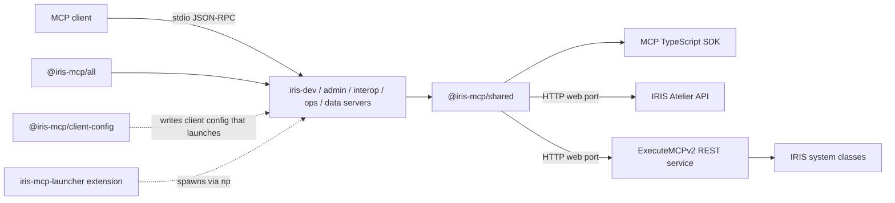
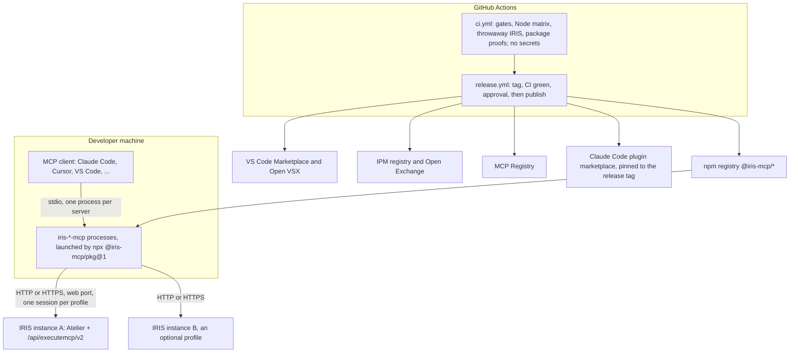

# Architecture Spine — IRIS MCP Server Suite

**How to read this spine.**

- **[ADOPTED].** Every AD records a decision already settled in `architecture.md`, the project rules, the PRD, or a Project Lead decision. The bracketed code after its title names the source.
- **[ASSUMPTION].** A bullet tagged this way is an inference made to close a seam between sources. The named story confirms or corrects it.
- ***(lands in Story N.M)*.** A clause tagged this way binds that story and every story after it. Before then, the current behavior is the known state and is never a review finding.
- **Precedence.** Where this spine disagrees with `architecture.md`, `prd.md` or `project-rules.md`, the spine wins. Rationale stays in those documents and in the memlog.

## Design Paradigm

**Layered ports-and-adapters with a single call-time interceptor chain.** An MCP client talks to one server process per package over stdio. Every call goes through one framework chokepoint, which:

1. validates the call;
2. selects the target IRIS instance;
3. enforces governance;
4. records audit;
5. invokes a thin domain handler.

Handlers reach IRIS only through one gateway, which talks to one of two IRIS-side adapters.

| Layer | Lives in | Owns |
| --- | --- | --- |
| Protocol port and framework | `packages/shared/src/` (`server-base.ts`, `governance*.ts`, `tool-visibility.ts`, `profiles.ts`, `config.ts`, `audit.ts`, `transport.ts`) | registration, the chokepoint, profiles, governance, visibility, audit, prompts and resources, the shared `instructions` string, the only use of the MCP SDK |
| Domain tool modules | `packages/iris-<domain>-mcp/src/tools/`, `src/prompts/` | one tool or tool family per file; typed arguments in, a `ToolResult` out |
| IRIS gateway | `packages/shared/src/http-client.ts`, `atelier.ts`, `bootstrap.ts` | sessions, CSRF, Atelier version negotiation, envelope parsing, bootstrap |
| IRIS-side adapters | the built-in Atelier API; `src/ExecuteMCPv2/REST/` (`Dispatch` routes, handlers extend `REST.Base`); the libraries `ExecuteMCPv2.Diagram.*` and `ExecuteMCPv2.Loc.*` | thin delegation to IRIS system classes |
| Distribution and agent content (outside the server runtime) | `packages/client-config`, `extensions/iris-mcp-launcher`, `packages/iris-mcp-all`, `skills/`, `scripts/`, `ipm/` | client wiring, launching, packaging, skills, CI, release |

## Invariants & Rules



Solid arrows are the only permitted runtime dependencies. Dotted arrows start processes; they never import code.

### AD-1 — IRIS is reached only over the web port, through one gateway [ADOPTED] (PRD differentiators; Boundary 2)

- **Binds:** every tool, bootstrap, FR1–FR15
- **Prevents:** a tool opening its own connection with its own auth, session or error handling
- **Rule:**
  - Every IRIS call goes through `IrisHttpClient` (`@iris-mcp/shared`), via `ctx.http`, over HTTP(S) to the instance's web port.
  - The call targets one of two IRIS paths:
    - the Atelier API, `/api/atelier/v<N>`, with N negotiated per profile;
    - the custom REST service, `/api/executemcp/v2`.

    A tool may use both.
  - There is no native driver, no SuperServer port, and no `fetch` in a handler.

### AD-2 — Package dependency direction [ADOPTED] (Rule #45)

- **Binds:** every package in `packages/` and `extensions/`
- **Prevents:** dependency cycles, and a server process loading configuration tooling
- **Rule:**
  - The five servers depend on `@iris-mcp/shared`.
  - `@iris-mcp/all` depends on the five servers.
  - `@iris-mcp/shared` never imports a server or any other leaf package.
  - `@iris-mcp/client-config` and `extensions/iris-mcp-launcher` are never runtime dependencies of a server. They only start servers.
  - A check that spans packages lives in `packages/iris-mcp-all` or in `scripts/`, and enumerates the built dist. This includes the skills-pack build and its provenance and tool-name checks. Such a check's CLI script and its test share one implementation.
  - `client-config` never depends on a server package.

### AD-3 — One call-time chokepoint [ADOPTED] (D2, D5, H3; core decisions)

- **Binds:** every tool call on all five servers; every `ToolDefinition`
- **Prevents:** per-tool copies of validation, profile selection, governance or audit, and any path that bypasses them
- **Rule:**
  - `McpServerBase.handleToolCall` runs these steps, in order:
    1. Zod validation;
    2. `server` → profile resolution;
    3. `action` extraction;
    4. the governance gate (a denial is a structured `isError` result, and the handler is not called);
    5. building the per-profile context;
    6. the handler.

    The audit interceptor wraps the whole sequence.
  - **Framework parameters.** `server` is injected into every input schema at registration and stripped before the handler runs.
  - **What handlers may use.** Only `ToolContext`: `http`, `resolveNamespace`, `resolveProfileClient`, `atelierVersion`, `paginate`, `config`, `governanceFileConfig` and the optional `confirm` (the AD-34 helper, present only on a wire call; Story 43.3, wave-8 decision #13). Handlers never read environment variables.
  - **Scope.** Every tool declares `scope` (`NS`, `SYS`, `BOTH` or `NONE`), which decides how its namespace resolves.
  - **Atelier versions.** A feature that needs a newer Atelier version calls `requireMinVersion` against the calling profile's negotiated version.

### AD-4 — Governance keys, classification and annotations [ADOPTED] (D4, F2, H6, L1; Rules #28, #32 and #44; S-3; Lead decisions 2026-10-15)

- **Binds:** every tool and action; `governance.ts`; every `ToolDefinition`
- **Prevents:** a new write or side effect shipping enabled by accident, a key rename that silently changes what is allowed, and a lockdown that reopens on upgrade
- **Rule:**
  - **Keys.** The governance key is `tool` for a single-operation tool and `tool:action` for a multi-action tool.
    - A new tool exposes as an `action` enum, with per-action `mutates`, any operation that mutates, or that an operator may want to govern separately, or that changes the class of data read (for example header data against body-derived data).
    - `mode` is only for presentation variants. The enum is fixed in the tool's first story.
  - **Classification.** Every post-foundation key declares `mutates: "read" | "write"`, and registration throws without it. The default seed enables reads and disables writes.
  - **New side effects.** A parameter that adds a new kind of side effect to an existing key (instance-wide state, a local file write) counts as a new operation. It goes on a governed companion key, unless a recorded Project Lead decision says otherwise.
  - **Enabled writes.** A write that ships enabled uses the `defaultEnabled` marker, never a `read` classification.
    - The marker addresses only `tool:action` keys, so the tool declares a per-action `mutates` record.
    - The holder list is closed: `iris_production_control:clean` (F2) and `iris_doc_edit:apply` (S-3; *lands in Story 38.4*). Adding a holder takes a recorded Project Lead decision.
    - Bulk and data-flow writes (resend, promote) are never holders.
    - On a `defaultEnabled` write, a guard override is a separate, default-disabled write action, never a parameter.
  - **Parent keys** *(lands in Story 38.4)*. A new key that re-exposes an existing key's capability declares that key as its `parent`:
    - `iris_doc_edit:apply` has the parent `iris_doc_put`;
    - `iris_sql_query` has the parent `iris_sql_execute`.

    The precedence rule is in AD-6.
  - **Frozen-baseline tools.** An `action` enum is never added to a frozen-baseline tool, because that renames its key. A new operation goes on a companion tool instead.
  - **Annotations.** Annotations follow the MCP definitions. "Destructive" means the tool can delete, or irreversibly overwrite, existing state.
    - New tools and new actions declare all four hints truthfully, independently of `mutates` and `defaultEnabled`.
    - An existing tool's hint changes only through a sanctioned AD-15 change. Story 42.10 corrected 13 existing tools to `destructiveHint: true` (DW-560, wave-8 decision #39). A non-read-only tool that declares `destructiveHint: false` is on a justified list, and no tool with a delete, remove, purge, kill or clean action may declare it; both are checked mechanically. (`iris_execute_tests`' `readOnlyHint: true` and `idempotentHint: true` were corrected to false in Story 40.4, DW-498. No write-classified key's tool now declares `readOnlyHint: true`, and a reverse-direction pin keeps it so.)
    - Hand-curated classifications are cross-checked mechanically against `readOnlyHint`.

### AD-5 — The governance baseline is frozen [ADOPTED] (D3, H1; Rules #20, #23 and #25)

- **Binds:** `governance-baseline.ts`, `baseline-classifications.ts`, `scripts/gen-governance-baseline.mjs`
- **Prevents:** grandfathering new writes as enabled, and silently losing an existing key
- **Rule:**
  - `GOVERNANCE_BASELINE` is frozen at hash `1e62c5ad5bf7` (141 keys) and is never regenerated.
  - The drift test is one-directional: every frozen key must still exist live.
  - Verification uses `pnpm gen:governance-baseline:check` only.
  - The key set of `baseline-classifications.ts` equals the baseline exactly, and an ambiguous entry is `write`.
  - Any future gate over existing capability follows the same pattern: a generated membership artifact, never a hand-maintained flag.

### AD-6 — One effective-policy cascade [ADOPTED] (H1, FR140; Story 32.0; Lead decision 2026-10-15)

- **Binds:** the governance engine; `IRIS_GOVERNANCE`, `IRIS_GOVERNANCE_FILE`, `IRIS_GOVERNANCE_PRESET`
- **Prevents:** configuration sources disagreeing on precedence, and discovery reporting a policy different from the one enforced
- **Rule:**
  - **Precedence.** For each key, the effective value is the first one found, in this order:
    1. the env profile layer;
    2. the env global layer;
    3. the file profile layer;
    4. the file global layer;
    5. the preset seed;
    6. the default seed.

    The layers never interleave: every `IRIS_GOVERNANCE` layer outranks every `IRIS_GOVERNANCE_FILE` layer. The file is read once, at startup.
  - **Parent keys** *(lands in Story 38.4)*. When a key's `parent` (AD-4) is explicitly disabled at any layer, the child seeds disabled. An explicit setting on the child still wins.
    - "Explicitly disabled" means the first explicit layer that sets the parent, in the precedence order above, sets it false. A lower layer's `false` does not count once a higher layer enables the parent. Only a disable is inherited: under the `read-only` preset an explicit `iris_doc_put: true` runs while `iris_doc_edit:apply` stays blocked by the preset.
    - An inherited verdict reports `configSource: "parent"`. The denial carries `inheritedFrom: "<parent key>"` and the text suffix ` (inherited from '<parent>')`. It does not carry `presetApplied` when the parent caused it. This is additive: no key had a parent before 38.4.
    - `parent` is declared per tool, so every action key of the child inherits it.
    - Orchestrator decisions #9 and #10, taken at the Story 38.4 spec gate on 2026-10-15 under the Lead's delegation.
  - **The `read-only` preset.** It blocks every write, including baseline and `defaultEnabled` writes. Explicit keys beat the preset.
    - An unknown preset fails fast.
    - A denial caused by the preset carries `presetApplied`.
  - **Reporting.** `iris_server_profiles` and the governance resource read the same engine, including inherited verdicts.

### AD-7 — Visibility is advertise-time and orthogonal to governance [ADOPTED] (I1, I2, Rule #53, L-4)

- **Binds:** `tool-visibility.ts`; every package's `src/tools/presets.ts`; FR138
- **Prevents:** hiding a tool being used as a safety control, and a new tool missing from a preset
- **Rule:**
  - **Resolution.** `IRIS_TOOLS_ENABLE`, then `IRIS_TOOLS_DISABLE`, then the preset, then visible. Trailing `*` wildcards are allowed.
  - **Hidden tools.** A hidden tool is absent from `tools/list` and cannot be called. Discovery reports hidden counts, never hidden names, and governance surfaces omit hidden tools' keys.
  - **Malformed values.** A malformed value fails fast. An unknown tool name only warns, because all five servers share one env block.
  - **Presets.** Every tool carries an explicit include or exclude in every named preset (`assertPresetCoverage`).
  - **Tool pairs.** A tool designed with a partner is declared in `TOOL_PAIRS`, and pairs are always co-visible. `iris_server_profiles` is always visible.
  - **The `core` preset.** It targets about 13 runtime tools per server, as a guideline, not a hard limit (L-4 supersedes the "≤13" wording in Rule #53 and FR138).
    - A tool in the everyday loop joins `core`, and the story records the resulting size.
    - When in doubt, exclude.
    - No story removes an existing `core` tool or changes another tool's preset rows; that goes to the Project Lead.
  - Visibility never replaces write-gating.

### AD-8 — Per-profile connections and failure semantics [ADOPTED] (D1, D7, M1)

- **Binds:** `profiles.ts`, `McpServerBase.start()`, FR145
- **Prevents:** sessions bleeding between instances, and one unreachable instance taking down the process
- **Rule:**
  - **One client per profile.** Each profile has one `IrisHttpClient` (cookie jar, CSRF token, negotiated Atelier version), never shared.
  - **One establishment path.** Every profile, `default` included, is established through `getOrCreateClient` → `establishProfile`, and a failed first touch can be retried. The startup attempt on `default` is a warm-up, never a gate.
  - **Failure semantics.** Invalid configuration fails fast at startup, naming the variable. An unreachable instance never exits the process: it surfaces per call as the structured connection error.
    - **Governance documents** (`IRIS_GOVERNANCE`, `IRIS_GOVERNANCE_FILE`; Story 38.7, DW-554). Some top-level keys look like governance but would be silently ignored. A key other than `global` or `profiles` fails fast, naming the documented shape, when it starts with `iris_` (any case) or its value is a boolean or an object. Metadata keys whose values are neither objects nor booleans (string, number, null or array), such as `comment` and `version`, stay valid (Story 32.4). An unknown profile name under `profiles` only warns (the AD-7 precedent). Orchestrator decision #19, 2026-10-16.
    - **Keys inside a layer** (Story 39.0, DW-565). A key that names a tool registered on this server but is none of that tool's keys logs one `[WARN]` per key, and never fails startup. A key that matches no tool of the whole suite is reported by `iris-mcp-governance check`, which exits 1. Servers never reject a foreign key, because one document is shared by all five servers and a newer server may add keys. Orchestrator decision #20, 2026-10-16.
  - **Discovery.** Discovery is connection-agnostic. Reachability is learned per call.

### AD-9 — Configuration channels and operator controls [ADOPTED] (D7, E1, J1, FR139, FR141)

- **Binds:** `config.ts`, `profiles.ts`, `credential-chain.ts`, the governance file, the Server Manager import, every operator control variable
- **Prevents:** credentials reaching the MCP client or a file, an untrusted repository injecting configuration, a caller overriding the operator, and a permissive local default loosening other instances
- **Rule:**
  - **Channels.** Configuration comes from:
    - environment variables (`IRIS_*`, including the JSON values `IRIS_PROFILES` and `IRIS_GOVERNANCE`);
    - file paths the operator supplies explicitly;
    - for Server Manager credentials, the OS keychain and `IRIS_CREDENTIAL_HELPER`.

    A new channel is never discovered from the working directory. CWD discovery is grandfathered only for `IRIS_SERVER_MANAGER`.
  - **Profile inheritance.** A profile inherits omitted *connection* fields from `default`. On a name collision, `IRIS_PROFILES` and env always win. Every roster entry carries `source` / `sourceFile`.
  - **Safety controls** (`dataPolicy`, SQL read-only mode, SQL caps):
    - they are never inherited from the `default` profile entry; a value on the `default` entry applies to `default` only;
    - an omitted per-profile value falls to the global operator variable, then to the safe default.
  - **Credentials.**
    - Tool arguments carry profile names, never credentials.
    - Discovery output is built from an allow-list of non-secret fields.
    - No distribution surface (client-config, the extension, the plugin) writes a literal credential to a file without FR141's explicit confirmation.
  - **Operator ceilings.** A caller parameter can tighten an operator control (read-only mode; row, time and size caps; `dataPolicy`) but never loosen it. A clamped value is noted in the response. This generalizes the H1 SQL clamps, which already report `rowsCapped`.

### AD-10 — Framework-provided surfaces are registered once [ADOPTED] (D6, E1, H2, Rule #31)

- **Binds:** `server-base.ts`; `iris_server_profiles`, the governance resource, the prompts capability, the shared MCP `instructions` string
- **Prevents:** per-package copies drifting apart, and tool counts that disagree
- **Rule:**
  - **Registration.** A surface every server offers is registered once in `@iris-mcp/shared` and appears on all five servers. It belongs to no package tool array, so it counts +1 per server's advertised total.
  - **The `instructions` string.** It is shared, so any change reaches all five servers.
  - **Capabilities.** `resources` and `prompts` are advertised only when something is registered.
  - **Tool counts.** Prompts carry no governance keys and change no tool count. Neither does a new action on an existing tool.

### AD-11 — One response envelope across both IRIS paths [ADOPTED] (Boundary 2; Story 34.4; Rules #7, #8 and #9)

- **Binds:** every custom REST handler; envelope parsing in `IrisHttpClient`
- **Prevents:** a different response shape per handler, and raw IRIS errors reaching clients
- **Rule:**
  - **Inheritance.** Every custom REST handler extends `ExecuteMCPv2.REST.Base`. `Base` extends `%Atelier.REST` and pre-flights JSON serialization. `Dispatch` extends `%Atelier.REST` and only routes.
  - **One render.** A request renders exactly one three-part envelope (`status.errors`, `console`, `result`). Output redirection is fully restored before that render.
  - **Error mapping.**
    - TypeScript maps a non-empty `status.errors` to `isError: true`.
    - IRIS-side status text passes through `ExecuteMCPv2.Utils.SanitizeError` before it leaves IRIS.
  - **Error classes.** On the tool-call path, IRIS and protocol failures use `IrisConnectionError`, `IrisApiError` and `McpProtocolError`. `ProfileResolutionError` is the framework's profile-lookup error. A new error class needs a recorded reason.

### AD-12 — Thin IRIS-side handlers; interpretation lives in TypeScript [ADOPTED] (Boundary 3, H5, G1, G2)

- **Binds:** `src/ExecuteMCPv2/REST/`, every new endpoint and IRIS-side library
- **Prevents:** judgment logic split across two runtimes, a bootstrap change for every heuristic tweak, and copied reference code
- **Rule:**
  - **Handler shape.** A handler validates input, switches namespace, delegates to IRIS system classes and returns raw data. Data from several sources is gathered in one round trip, with a Try/Catch per area.
  - **Where judgment lives.** Thresholds, verdicts and advisory heuristics live in TypeScript.
  - **Recorded IRIS-side exceptions:**
    - the `ExecuteMCPv2.Diagram.*` generation library;
    - the `ExecuteMCPv2.Loc.*` counting library;
    - redacting submitted secrets from IRIS error text (`SanitizeError`);
    - checks that must run before commit or atomically (the AD-25 caps, the AD-27 busy checks), with TypeScript passing in the limit;
    - validating identifiers and operators that the same handler builds into a statement (AD-26). Validation in TypeScript is only advisory.
  - **Reference code.** A reference implementation is a functional spec only, never copied.

### AD-13 — Namespace switching on the IRIS side [ADOPTED] (core decision; IRIS basics rule)

- **Binds:** every REST handler and entry point into an IRIS-side library
- **Prevents:** `<CLASS DOES NOT EXIST>` in catch paths, and the namespace leaking between requests
- **Rule:**
  - Save `$NAMESPACE` to a local variable and switch with `Set $NAMESPACE`.
  - Restore it on every exit path, starting with the catch block.
  - Never use `New $NAMESPACE` in a REST handler.
  - Validate input before switching to `%SYS`. `Config.*` and `Security.*` calls run in `%SYS`.

### AD-14 — Bootstrap, IPM and generated artifacts [ADOPTED] (D6, D8; Rules #18, #24, #39 and #57; N7)

- **Binds:** `bootstrap.ts`, `bootstrap-classes.ts`, `scripts/gen-bootstrap.mjs`, `ipm/module.xml`, `Setup.cls`, every generated or installer-managed file
- **Prevents:** hand-edits lost at the next regeneration, server and IRIS class versions drifting apart unnoticed, and two owners of one deployment
- **Rule:**
  - **The embed.** The IRIS-side classes ship embedded in `@iris-mcp/shared` (`bootstrap-classes.ts`, generated and output-only). They are deployed by Atelier PUT plus compile:
    - **when.** On each profile's first establishment, the `default` warm-up included. All five servers declare that they need the custom REST service.
    - **how often.** At most once per profile.
    - **on failure.** The per-step report is logged with manual remediation, never as a silent no-op.
    - **governance.** Bootstrap is part of establishing a connection and is never a governed action.
  - **Class order.** `classes[]` is in compile order: Utils, Setup, the libraries, `REST/Base`, the handlers, and `REST/Dispatch` last. `ExecuteMCPv2.Tests.*` and fixture classes are never in it.
  - **Changing a class.** A change to any bootstrapped class regenerates the embed in the same story, which moves `BOOTSTRAP_VERSION`. A new class joins both rosters: `gen-bootstrap.mjs` and `bootstrap.test.ts`.
  - **Generated and installer-managed files.** A generated file (with a DO-NOT-EDIT header) changes only through its generator. An installer-managed BMAD file changes only through `_bmad/custom/` overlays.
  - **Downgrades** *(lands in Story 42.2)*. The deployed version is monotonic, and a deployment from a newer build is never downgraded. Until then, the equality comparison is the known gap DW-508.
  - **The IPM manifest** *(lands in Story 42.4)*. `ipm/module.xml` is generated from the same class list. IPM archives are built from the generator's stamped output, never from `src/`. The module version equals the npm version.
  - **The version marker** [ASSUMPTION] *(Stories 42.2 and 42.4 confirm)*:
    - **Format.** It is `<semver of @iris-mcp/shared>+<content hash>`, stamped at generation.
    - **Ordering.** Markers order by semver. An equal semver with a different hash counts as *foreign*, and so does the `"dev"` placeholder in source `Setup.cls`. A foreign marker means no redeploy, plus a warning naming both markers.
    - **Ownership.** Each deployment has one owner. When IPM installed the classes, bootstrap never redeploys; it reports the mismatch and the `zpm` command.
    - **IPM upgrades.** The IPM install and upgrade path runs the same no-downgrade check, IRIS-side.
    - **Concurrency.** Deployment re-checks the marker immediately before it compiles `Setup`.
  - **Version-embedding artifacts** *(lands in Story 42.5)*. A root `version` script, run by the Changesets version step, regenerates every artifact that embeds the version. The tag commit passes every `:check`.

### AD-15 — Backward compatibility is proven mechanically [ADOPTED] (D2, Rule #19, PRD Security release gate)

- **Binds:** every story that touches an existing tool, schema, prompt, environment variable or startup path
- **Prevents:** "off means today's behavior" being asserted in prose and broken in fact
- **Rule:**
  - **Unused features.** When a new feature is unused, every pre-existing field of every request and response is byte-identical to before. A test proves it and fails on drift, either by pinning the old shape with new keys removed, or by pinning the full new shape in the story that adds them.
  - **Additive changes.** Adding an optional input field, or a new output field, is non-breaking.
  - **Breaking changes.** Removing, renaming or retyping an existing field, or changing its default, is breaking.
  - **Sanctioned changes.** A change to an existing name, parameter, default or output shape needs a recorded Project Lead decision. The sanctioned changes in this wave were approved with the 2026-10-14 proposal and the 2026-10-15 spine review:
    - transport rejection (S-2);
    - storage-drop refusal on `iris_doc_put`;
    - the default `redact` policy over the resend preview (L-2);
    - the `iris_execute_tests` annotation correction;
    - the retirement of the `objectscript-review` prompt (Story 41.2, wave-7 decision #4; its checklist is now the always-on rule);
    - the `@1` pin (D3) and the Node 22 floor (D4);
    - the human confirmation dialog on existing confirmation gates for elicitation-capable clients (AD-34, Story 43.3);
    - the `IRIS_NAMESPACE` default moving from `HSCUSTOM` to `USER` (the documented value, which exists on every IRIS instance), in `config.ts` and the VS Code launcher, recorded under CHANGELOG "Changed" (DW-469, Story 38.0). The orchestrator decided this under the Lead's delegation for the unattended run of 2026-10-15; see `orchestrator-decisions-wave-6.md` #5.
    - **Story 39.7** (orchestrator decisions #30–#35, made under the same delegation):
      - every non-2xx Atelier response is now an error, even when its error list is empty (DW-569). `iris_doc_search` with an empty query becomes an error; `iris_macro_info` with no document keeps its documented empty result;
      - `iris_production_logs` and `iris_message_diagram` withhold message-derived text under `block`;
      - `iris_message_body` renders character-stream bodies under `allow`;
      - the message-search statements carry an index hint, which changes the plan only, never results.
    - **Story 40.5** (orchestrator decisions #65 to #67): prompt-text fixes. `recover-stuck-production` gains the `block` report-the-reason rule for withheld Event Log text. `edit-and-test-class` gains the `PRODUCTION_BUSY` note. The `PRODUCTION_BUSY` wording in both test prompts covers the unreadable-state refusal. Names, titles and arguments are unchanged.
    - **Story 40.4** (orchestrator decisions #62 and #63): `iris_execute_tests` now declares `readOnlyHint: false` and `idempotentHint: false` (the listed annotation correction, DW-498). The `deploy-and-test-class` prompt gains an optional coverage step and a `PRODUCTION_BUSY` note, and its description gains one clause; its name, title and arguments are unchanged.
    - **Story 40.3** (orchestrator decision #56): `iris_execute_tests` and `iris_test_coverage` refuse a run that contains `%UnitTest.TestProduction` tests while a different production runs in the namespace (`PRODUCTION_BUSY`). Before this, such a run silently stopped the other production. A run with no TestProduction test, a run on a server without the ExecuteMCPv2 service (the guard route answers 404), and a run in a namespace that cannot see the ExecuteMCPv2 classes (decision #60) behave exactly as before; the last two are unguarded, and the descriptions say so. A method-level target whose method part holds `;`, `,` or `^` is now refused as malformed (decision #61). The test runner reads those characters as "more classes", "another spec" and "run this setup code", so `A:TestX;B` no longer runs two classes.
    - **Story 40.0** (orchestrator decisions #36 and #38, made under the same delegation):
      - the `trace-message-flow` prompt tells agents, under `block`, to report the reason for withheld Event Log and diagram error text and never read it another way (DW-587);
      - `iris_metrics_interop` `errorCount24h` counts Error entries (it counted Warning), and both it and `messageCount24h` cover the 24 hours before the call in UTC (DW-584);
      - the `iris_production_logs` `type` filter maps a display name such as `Error` to its stored number; a numeric value still matches as before (DW-585).
    - **Story 43.1** (wave-8 decisions #1, #2, #4 and #6):
      - a `prompts/get` that omits `arguments` renders like `{}` for a prompt whose arguments are all optional, where v1 refused it with -32602 (DW-617);
      - a schema-invalid `tools/call` now writes its one audit entry: `outcome` `error`, the raw top-level key names only, never `params` (DW-579, AD-19). This is an additive audit behavior; the wire is unchanged.
      - `addTools` sends one `notifications/tools/list_changed` per call instead of one per tool plus one. Nothing in production calls `addTools` or `removeTools` (wave-8 decision #4).
      - a malformed `tools/call` request (no `params`, `name` missing or not a string, `arguments` not an object) is refused with `-32602 Invalid tools/call request: …`, where v1 answered `-32603` with the bare schema text (wave-8 decision #6);
      - a `tools/call` that carries a `task` parameter runs as a plain call, because the server advertises no `tasks` capability, where v1 refused it with `-32603 Server does not support task creation` (wave-8 decision #6). Only a client that ignores the capability list sends either request.
      - The result member order is NOT a change: v1 already re-encoded every `tools/call` result in its schema order (`content`, `structuredContent`, `isError`), so the exception decision #4 also recorded was withdrawn (wave-8 decision #5).
    - **Story 43.4** (wave-8 decisions #23 and #24):
      - `S-43.4-descriptions`: the descriptions of `iris_audit_manage`, `iris_env_promote`, `iris_production_control`, `iris_message_resend` and `iris_doc_edit` each gain one appended passage that names the confirmation dialog. No other byte of any description changes.
      - `S-43.4-governance-resource`: `resources/list` lists `iris-governance://default` once, as the static resource, where the per-profile resource template's list repeated it (DW-646).
      - `S-43.4-prompt-text`: the `resend-failed-messages` prompt's steps 3 and 4 say that an over-cap count is refused when the resend executes, and that leaving out `dryRun` previews again (DW-653). Its name, title, description and arguments are unchanged.

      The frozen Story 43.1 goldens stay byte-unchanged: each change to bytes they hold is one entry of `fixtures/sdk-golden-sanctioned-changes.json` (DW-639).
    - **Story 42.10** (wave-8 decisions #38 to #40):
      - `S-42.10-annotations`: 13 existing tools change `destructiveHint` from `false` to `true`: `iris_doc_put`, `iris_sql_execute`, `iris_global_set`, `iris_execute_command`, `iris_execute_classmethod`, `iris_doc_load`, `iris_doc_export`, `iris_env_promote`, `iris_service_manage`, `iris_ldap_manage`, `iris_x509_manage`, `iris_production_item` and `iris_task_run` (DW-560).
      - `S-42.10-resend-text`: the `iris_message_resend` description and its `maxMessages` and `confirm` texts are corrected, not appended: executing needs `dryRun: false` and `confirm: true`, `dryRun: false` without `confirm` is refused, a call that leaves out `dryRun` previews, and only an executing over-cap call is refused (DW-662).
      - `S-42.10-audit-namespace`: the audit entry of a `SYS`-scoped tool records `%SYS`, and the additive `targetNamespace` field carries the call's `namespace` argument when it has one (DW-654, AD-19, decision #41).

    Each change may land in the earliest story that needs it, and is named in `CHANGELOG.md` with that story. Prune this list into the CHANGELOG at the Epic 42 retro.
  - **After `1.0.0`.** A breaking change requires a new major version. Clients pinned to `@1` receive every 1.x release automatically.
  - **Dropping an end-of-life Node major** [ASSUMPTION] is a minor-version change, announced in `CHANGELOG.md`.

### AD-16 — Tools that front asynchronous server jobs [ADOPTED] (L1)

- **Binds:** `iris_execute_tests`, `iris_test_status`, every future tool backed by an asynchronous job, including coverage
- **Prevents:** a client wait budget being reported as a terminal error, and results that become unreachable once the call has returned
- **Rule:**
  - **Budget expiry.** When the budget expires, the tool returns `isError: false` with `status: "running"`, every durable handle it holds, and any partial results labelled as partial. Handles are also returned on completion.
  - **The companion.** Re-attach, read and cancel live on a separate, read-classified companion tool, whose write actions are classified separately. Every result a completed run returns can be reproduced by the companion from the durable handles alone.
  - **Pairing.** When a primary's `running` result can be resolved only through its companion, the two are declared in `TOOL_PAIRS`. That needs a Lead decision if it moves a `core` row.
  - **Local files.** A companion that writes a local file takes an explicit `outputPath`. The write is its own governed action, classified write and disabled by default: coverage's Cobertura file is `iris_test_status:export`, which exports completed runs only (Story 40.2, decision #50).
  - **Handle lifetime.** A handle lives as long as the server-side state it names. The Atelier `jobId` and the coverage `coverageRunId` (Story 40.1, decision #42) are kept in IRIS temporary storage, so neither survives an instance restart, and an unknown handle's error says so.

### AD-17 — Bulk and data-loss writes are bounded server-side [ADOPTED] (F1, H6)

- **Binds:** `iris_message_resend` (`resend`, `resendFiltered`), `iris_env_promote` (`execute`), `iris_production_control:clean`, and future bulk writes
- **Prevents:** one call mutating an unbounded set of data
- **Rule:**
  - **(a) Bulk and multi-item writes.**
    - Required filters, windows and hard caps are enforced in the server before any mutation, and a request over a cap is refused, never truncated.
    - Dry run is the default, and executing requires `confirm: true`.
    - A promote plan embeds the content hash of its source diff, so a stale plan cannot execute.
    - Execute accepts only allowlisted plan steps and halts on the first error.
    - Drift never produces delete steps.
  - **(b) `iris_production_control:clean`.** It runs immediately, and only `killAppData` requires `confirm: true`.
  - **(c) Single-document writes and SQL DML.** These are governed by AD-24 and AD-25, not by this AD.
  - **Refusals.** Any refusal changes nothing.
  - **The shared search helper.** A search helper shared by a write and a read (Story 39.1) owns only the translation from filters to a query. Each caller keeps its own required filters, windows, caps and its choice between refusing and truncating. A refusal test over direct REST pins the write's guards before and after the extraction.

### AD-18 — Cross-profile operations [ADOPTED] (H4)

- **Binds:** `ToolContext.resolveProfileClient`, `iris_env_diff`, `iris_env_promote`
- **Prevents:** a permissive profile being used to write into a governance-locked one
- **Rule:**
  - A second profile's client comes from the same per-profile registry (AD-8).
  - The call-time gate governs the calling profile.
  - A write against another profile also checks that target profile's effective policy for the underlying write keys. A refusal names the blocking key.

### AD-19 — The audit trail is server configuration, never a tool [ADOPTED] (H3, FR137)

- **Binds:** `audit.ts`; `IRIS_AUDIT_LOG`, `IRIS_AUDIT_LOG_MAX_MB`, `IRIS_AUDIT_LOG_PARAMS`; every `dataPolicy`-governed tool
- **Prevents:** an AI client switching off an operator-mandated trail, auditing slowing or failing calls, and PHI reaching the log
- **Rule:**
  - **Writing entries.** One JSONL entry is written per call from the chokepoint (AD-3). Audit cannot be expressed in `IRIS_GOVERNANCE`.
    - **Multi-round calls** *(Story 43.3, wave-8 decisions #14 and #18)*. A multi-round request, such as an AD-34 confirmation, is one logical call. Its one entry is written by the round that ends it, and an asking round writes none.
    - **A confirmation never answered** is written as `error`, with `confirmation: "unanswered"`, after its 600 s TTL, when the client closes the connection, or at a graceful `stop()`, so every asked dialog has its entry. A server killed by a signal writes none (DW-659, accepted: MCP stdio clients close stdin first).
    - **A call cancelled before its dialog is shown** is audited at once as the cancelled call, and leaves no pending ask.
    - **A decline** (`CONFIRMATION_DECLINED`) is `denied`. The additive `confirmation` field records `accepted`, `declined`, `cancelled`, `unconfirmed` or `unanswered`.
    - **A call the client cancels** is `error`, with a fixed text saying an in-flight IRIS request was aborted.
  - **Secrets.** They are redacted before an entry is queued.
  - **Failure handling.** The writer never fails or delays a tool call. Only an unwritable path at startup fails fast.
  - **Schema.** `outcome` keeps its closed domain (`ok`, `error`, `denied`). New fields are additive. For a `SYS`-scoped tool, `namespace` is `%SYS`, where the call runs; when such a call has a non-empty string `namespace` argument, the additive `targetNamespace` field records it, whatever `IRIS_AUDIT_LOG_PARAMS` says. That includes the tools that document the argument as having no effect. For every other tool, `namespace` is the call's override or the profile's default (Story 42.10, DW-654, wave-8 decision #41).
  - **PHI** *(lands in Story 39.2)*:
    - Policy effects go in a new additive field, and a policy refusal is `error` with its own refusal code.
    - PHI-bearing inputs are declared on the `ToolDefinition` with a schema-level marker. Audit redacts by that declaration, under the profile's policy, never by matching parameter names.
    - A governed tool's error text never echoes a caller value or body content.

### AD-20 — Enumerating tools need a caller-supplied scope [ADOPTED] (Rule #38)

- **Binds:** every tool whose work scales with the documents or rows it scans
- **Prevents:** whole-namespace scans that hit the roughly 60-second Web Gateway timeout
- **Rule:**
  - A scope filter is required.
  - A whole-namespace run is an explicit opt-in, documented with its timeout risk.
  - An output cap limits the output only, and is never presented as timeout protection.

### AD-21 — Identity and key construction [ADOPTED] (K1, Rules #29 and #50)

- **Binds:** path-mapping tools, composite IdKeys, every diff, sync and match key
- **Prevents:** silently writing to the wrong document or row, and diffs that cannot match anything
- **Rule:**
  - An identifier derived from a path is cross-validated against the identity its content declares, where one exists.
  - A user-supplied slot that contains the composite-key delimiter is rejected before the key is assembled.
  - A cross-side match key contains only dimensions of the item's own identity. Side dimensions belong in the compared value.

### AD-22 — Interoperability configuration source of truth [ADOPTED] (Rule #27)

- **Binds:** production item and setting handlers (`Ens.Config.*`)
- **Prevents:** operating on a stale item list
- **Rule:**
  - The production class XData is the source of truth, and the `Ens.Config.Item` extent is a cache.
  - Add and remove flows call `Ens.Config.Production.LoadFromClass(<production>)` before `%OpenId`.
  - Name lookups use the composite `(Production, Name)` index.

### AD-23 — Transport is stdio only [ADOPTED] (N1, S-2) *(lands in Story 38.1)*

- **Binds:** `transport.ts`, `McpServerBase.start()`, FR7
- **Prevents:** advertising a transport the server cannot run
- **Rule:**
  - Any transport other than `stdio` is rejected in `resolveTransport` as a configuration error (AD-8), before any IRIS traffic.
  - An HTTP transport is added only together with an authentication, bind-address and session design.
  - Story 38.1 (commit `5f8b1e0`) enforces this. Every configured value (each `--transport` value, and `MCP_TRANSPORT` when it is non-empty) must be exactly `stdio`, and anything else is rejected with exit 1 before any IRIS traffic. An empty `MCP_TRANSPORT` means not configured. Before 38.1, `transport.ts` accepted `http`, and an unknown value fell back to stdio with a warning.

### AD-24 — Agent document writes are guarded and minimal [ADOPTED] (N2, S-3) *(lands in Stories 38.2 to 38.4)*

- **Binds:** `iris_doc_get`, `iris_doc_put`, `iris_doc_edit`, and every document-writing path; FR146–FR148
- **Prevents:** reads and edits disagreeing about lines, edits that overwrite unseen changes, and silent loss of storage
- **Rule:**
  - **Lines.** One `@iris-mcp/shared` line utility owns all of the following:
    - numbering: 1-based indexes into the content array that Atelier's `GET /doc` returns;
    - splitting on `\r?\n` and joining with `\n`;
    - BOM handling;
    - the single numbered-text format.

    Reads, `expected` and `text` parsing, and edit excerpts all go through it. Ranges are defined only on UDL text documents.
  - **Versions.** A ranged read returns the document's version token (`ts` or ETag). An edit's PUT sends, as `If-None-Match`, the token of the GET its `expected` check ran against.
    - A 409 is reported as a conflict and is never retried.
    - An agent edit never sends `ignoreConflict`.
    - Story 38.2 records what Atelier does when the header is missing.
  - **Edits.**
    - Every edit is guarded by expected text and applied all-or-nothing.
    - The response is computed from a re-read after the PUT, never from the locally applied array.
  - **Storage guard.** One shared Storage-drop guard covers `iris_doc_put` and `iris_doc_edit`.
    - Story 38.3 enumerates every document-writing path (Atelier PUT, `xml/load`, bootstrap PUT), exhaustive as of a named date, and gives each a verdict.
    - Recorded exclusions so far: `iris_doc_load`, the `iris_env_promote` `execute` sync, and the `iris_doc_xml_export` import (`xml/load`), each with a ledger reopen trigger. The xml import was added at the Story 38.3 spec gate, 2026-10-15, as orchestrator decision #8 under the Lead's delegation.
    - **Existing documents (Story 38.3, DW-540).** Without `If-None-Match`, Atelier refuses a PUT to an existing document with a 409 that carries the current document and its `ts`, and writes nothing. `iris_doc_put` uses that 409 as the guard's read and as the version token: it retries the save once with `If-None-Match: <ts>`. A 409 on that version-checked save is a conflict, and it is never retried.
    - A grep test fails on any new path that has no verdict.
  - **`iris_doc_edit`.** It exposes `apply`, a `defaultEnabled` write, and `regenerateStorage`, a default-disabled override action (AD-4).

### AD-25 — SQL safety is enforced server-side [ADOPTED] (N3, H1, L-3) *(lands in Story 38.5)*

- **Binds:** `iris_sql_execute`, `iris_sql_query`; FR149
- **Prevents:** keyword matching letting writes through, read-only setups losing all queries, read paths that write through SQL functions, and two serializers
- **Rule:**
  - **Classification.** The statement type is used, wherever the Story 38.5 probe confirms it is available. Classification and execution run on the same prepared statement, in one IRIS call.
  - **Read paths.** `iris_sql_query` and the read-only mode of `iris_sql_execute` run inside a transaction that is always rolled back.
    - The remaining non-transactional effects are listed in the tool description.
    - The docs call the mode "statement-level read-only".
  - **Caps.** Rows-affected caps are enforced transactionally, inside IRIS, before commit. The existing `IRIS_SQL_MAX_ROWS` and `IRIS_SQL_TIMEOUT` clamps stay.
    - Under a cap, only SELECT, INSERT, UPDATE and DELETE (statement types 1–4) run. Every other type, including DDL and `CALL`, is refused before execution, because its row count is not trustworthy (`CALL` reports 0), so it would get past the ceiling unseen. This is orchestrator decision #13 at the Story 38.5 spec gate, 2026-10-15.
    - `TRUNCATE TABLE` is type 4, the same type as DELETE. It runs inside the capped transaction, and its -1 ("unknown") count rolls it back. This fails safe: live, every row was intact. Amended 2026-10-16 as orchestrator decision #15; the earlier wording said TRUNCATE was refused before execution.
    - **`%NOJOURN`.** A type 2–4 statement with the `%NOJOURN` token turns journaling off, so a rollback cannot undo its writes. Under a cap it is refused before execution by a refuse-only token check, the one keyword check in the safety path; a false positive can only refuse. This is orchestrator decision #14, 2026-10-16, from Story 38.5 code review round 1.
    - All `iris_sql_execute` calls run on the custom SQL endpoint, so there is one serializer. SQL error text keeps the SQLCODE and the IRIS message. This is orchestrator decision #12.
    - The 38.5 probe found that a rollback does not undo `$INCREMENT`/`$SEQUENCE` counters, row-ID counters, process-private and IRISTEMP globals, `JOB` or device output, or a function, procedure or trigger that ends or opens a transaction (`TCOMMIT` inside a function persists its writes).
  - **One serializer.** All SQL tools share one result serializer and select mode, pinned against `action/query` output on a fixture with dates, nulls, `%List` values and streams.
  - **The `read-only` preset.** Queries under it go through the read-classified `iris_sql_query`, whose parent key is `iris_sql_execute`. A weakened write key is never the route.
  - **Which tools the operator SQL controls bind.** Every tool that executes caller-supplied SQL text (`iris_sql_execute`, `iris_sql_query`).
    - Story 38.5 records whether `iris_sql_analyze`'s `explain` and `indexUsage` paths are in scope.
    - Tools that build their own SQL are bound by AD-20 and AD-26 instead.

### AD-26 — Message forensics: no interpolated input; one PHI policy over body data [ADOPTED] (N4, L-2) *(lands in Stories 39.1 to 39.5)*

- **Binds:**
  - `iris_message_search` (`headers`, `body` and `searchTable` actions);
  - `iris_message_body`;
  - the `iris_message_resend` preview;
  - every surface that returns body or body-derived text;
  - FR150–FR152.
- **Prevents:** injection through filters, PHI passing because a body reached redaction truncated or flattened, and body-derived text leaking through an unowned surface
- **Rule:**
  - **Filters.** Body and Search Table filters are structured values.
    - Their identifiers and operators are validated IRIS-side, in the handler that builds the statement.
    - Properties resolve to their dictionary `SqlFieldName` and are emitted as delimited identifiers.
    - Operators map from a closed enum.
    - Values are always passed as parameters.
    - Fuzz tests drive the REST route directly.
  - **The policy.** A per-profile `dataPolicy` (`block`, `redact` or `allow`; default `redact`) applies to every body-derived output. It is never inherited from the `default` entry (AD-9).
  - **Configuration** (Story 39.2, orchestrator decisions #23–#26, 2026-10-16).
    - `dataPolicy` resolves per profile at startup, taking the first value found: the profile's `IRIS_PROFILES` `dataPolicy`, then `IRIS_DATA_POLICY`, then the governance file's `dataPolicy.profiles.<name>`, then its `dataPolicy.global`, then `redact`.
    - `IRIS_GOVERNANCE` does not carry it. A malformed value fails startup naming its channel. An unknown profile name only warns.
    - `iris_server_profiles` reports `dataPolicy` and `dataPolicySource`.
    - Body kind comes from `MessageSearch.BodyKind`. Only `hl7v2` is redactable, by a fail-closed keep-list (`hl7-redaction.ts`): a field nobody reviewed is redacted, never kept.
    - **Least exposure by default.** Under `redact`, no surface shows more body text than it did before this policy existed. The resend preview keeps its HL7 class-name note and withholds non-HL7 bodies with a reason. The engine's first body-text consumer is `iris_message_body` (Story 39.5).
    - In 39.2 the policy governed the resend preview only.
    - Since Story 39.7, `iris_production_logs` (Event Log `Text`) and `iris_message_diagram` (the Correlator's `Error on message …` texts) are governed under `block` only: their message-derived text is withheld with a fixed reason. Under `redact` and `allow` they are byte-identical to before and stay documented residuals, because free log text cannot be redacted reliably and content sniffing is forbidden (decision #31).
      - The diagram generator's own `Generation failed for session N: …` text is not withheld under `block`: it carries only a SQL schema error or a system error name and location, and no reachable code path puts message content in it (Story 40.0 probe, DW-586). Revisit if a Diagram stage's exception data or SQL `%Message` ever echoes a header field value.
    - Under `allow`, `iris_message_body` renders character-stream property bodies (for example `HS.Message.XMLMessage` `ContentStream`) within `maxChars`. They are withheld under `redact` and kind-only under `block` (decision #32).
    - The scope as of 2026-10-16 is recorded in `tool_support.md`.
  - **What redaction may read.** Redaction runs only on the complete, unsanitized body. Truncation and sanitization come after redaction, in TypeScript.
    - Body kind comes from the body class, through one shared classifier owned by Story 39.2, never from sniffing content.
    - Under `redact`, a body type the engine cannot redact reliably is blocked, and so is any surface that can supply only a pre-truncated or pre-sanitized body.
  - **Scope.** Story 39.2 classifies every tool that can return body or body-derived text, exhaustive as of a named date, as governed, residual (operators restrict it through governance) or not applicable. The candidates include:
    - generic SQL, global and document tools;
    - `iris_production_logs`;
    - header `ErrorStatus` and `Description`;
    - `iris_message_diagram`;
    - execution output.
  - **Configuration.** Story 39.2 records the configuration model. It follows AD-6 and M1, and `iris_server_profiles` reports it.
  - **Compliance claims.** No document or listing claims regulatory compliance.

### AD-27 — Instance-wide monitors are job-owned, refuse-if-busy and always released [ADOPTED] (N5) *(lands in Stories 40.1 and 40.3)*

- **Binds:** LineByLine coverage, TestProduction production control, any future instance-wide singleton; FR153–FR154
- **Prevents:** one caller's tool disrupting another user of a shared instance, and a leaked session locking every later run out
- **Rule:**
  - **Ownership.** One IRIS-side job owns a monitor's lifetime: it starts the monitor, runs the work and stops it in its own cleanup.
    - A client wait budget, a poll or a cancel never starts or stops a monitor directly; a cancel only signals the job.
    - So coverage runs only on an execution path whose job the suite controls.
    - **Coverage uses two suite jobs** (Story 40.1, orchestrator decisions #40 and #41). A runner starts its own session, runs the tests and stops the session in its cleanup. A supervisor turns a cancel or the time limit into terminating the runner, and releases a session the runner left behind. This split exists because `$SYSTEM.Process.Terminate` cannot be trapped, so the process running the tests cannot be the only one that releases the monitor. The session's process list is exactly these two processes (decision #45), because only a listed process can read a session's routine names and counts. It is never all processes and never another process.
    - **What proves a session is the suite's.** A session's process list counts as evidence only while the session is process-scoped. In all-processes or paused mode the list IRIS reports does not describe the session's scope (probes saw both a previous session's list and the starting process's own list), so it proves nothing. A releaser stops a session only after proving it is its own, and the two releasers never act at the same time (Story 40.1 review).
    - **Terminate only proven processes.** The suite terminates a process only after proving, immediately before, that it is still the suite's own: the PID matches the owner record and that role's owner lock is still held. A PID can be reused once its process dies.
  - **Owner records.** The suite records a session's owner (job id and start time) durably. A later run may reclaim a suite-owned session whose job is dead. A session without a suite ownership record is never touched.
  - **Busy checks.**
    - A coverage run is refused while a foreign session is active.
    - A TestProduction run is refused while a production other than the test's own is running in the target namespace.
      - **Where and how** (Story 40.3, orchestrator decisions #56 to #58). Both test-running tools ask one IRIS-side guard before anything runs. It decides under Ens's own lifecycle lock `^Ens.Runtime`. The test's own production is started later by `%UnitTest.TestProduction` in another process, so the window between the decision and that start is a recorded residual.
      - **The suite never stops a production**, not even one a killed or failed TestProduction run left behind. Ens records no owner, so a leftover cannot be told apart from a live production. Any production other than the run's own is refused and named, with the recovery in the text, and left untouched.
    - The busy check is atomic (AD-12).
  - **Fixtures.** Coverage oracles are captured in a disposable namespace whose routines nobody else runs.

### AD-28 — Agent content and third-party material [ADOPTED] (H2, N6, G2; decision record Part 2; D5; Lead decision 2026-10-15) *(lands in Stories 41.1 to 41.7)*

- **Binds:** `packages/*/src/prompts/`, `skills/`, the skills pack, the notice file, every published name and listing; FR133, FR155–FR156
- **Prevents:** prompts and skills drifting apart, adapted content shipping without its licence, two copies of one pack, and anything implying InterSystems' endorsement
- **Rule:**
  - **Prompts and workflow skills.** MCP prompts are authored once, in `packages/*/src/prompts/`. The workflow skills are generated from them (`gen:skills`, verified with `--check`).
    - A skill's model-invocation description is a separate field on its prompt definition. Only `gen:skills` reads it, and a pin proves it never reaches `prompts/list`.
  - **Knowledge skills and the always-on rule.** Each hand-authored knowledge skill, and the always-on rule, has exactly one source.
    - The rule is unscoped (no `paths:`), so it loads in every session of a project that installed it.
    - Plugins cannot carry rules, so rules reach Claude Code only through the installer.
  - **One pack** *(decided in Story 41.1, orchestrator decision wave-7 #1)*. The pack is the committed, generated, DO-NOT-EDIT directory `packages/client-config/skills-pack/`. Only `pnpm gen:pack` writes it. `pnpm gen:pack:check` runs in the default suite and fails on any missing, changed or stray file.
    - **Sources.** Each knowledge skill, the always-on rule and the notice has one hand-authored source in `skills-pack-src/`: skills under `knowledge/<name>/`, the rule under `rules/`, and the notice at the root. The workflow skills stay `gen:skills` output in `skills/`. `gen:skills` owns only `skills/`, so it never sees a hand-authored file. `gen:pack` copies both sources byte for byte, needs no build, and renders only the pack README (a catalog of the knowledge skills, the workflow skills and the rules, Story 41.5), each rule's `AGENTS.md` section form (Story 41.2, wave-7 decision #5) and each rule's Cursor form (Story 41.6, wave-7 decision #25).
    - **The always-on rule's source** is `skills-pack-src/rules/iris-mcp-objectscript-pre-write.md` (Story 41.2): one flat `<name>.md` per rule, without frontmatter. It names no `iris_*` tool, so it declares no preset.
    - **The core knowledge skills** (Story 41.3, wave-7 decisions #7 and #8) are `iris-mcp-objectscript-gotchas`, `iris-mcp-objectscript-error-handling` and `iris-mcp-objectscript-unit-tests`. Like the rule, they name no `iris_*` tool, so they declare no preset.
    - **The platform knowledge skills** (Story 41.4, wave-7 decisions #12 to #14) are `iris-mcp-objectscript-sql`, `iris-mcp-system-classes` and `iris-mcp-interoperability`, which brings the knowledge-skill count to six. They are also tool-free. `iris-mcp-objectscript-sql` is adapted from upstream `objectscript-sql-patterns` at `b6205bb` and carries the pack's first provenance row; its one false explanation, that an object property set to `""` is not `NULL` in SQL, is corrected in the adapted text.
    - **Skill frontmatter.** Every `SKILL.md` in the pack opens with frontmatter on its first line (no byte-order mark, wave-7 decision #10), holding `name` and `description` and, optionally, a `metadata` map whose one allowed key is `iris-tools-preset` (Story 41.5, wave-7 decision #16). `name` equals its directory and is lower-case letters and digits in hyphen-joined groups, at most 64 characters, without `claude` or `anthropic`. `description` is at most 1,024 characters, with no XML tag. `check:provenance` enforces this with its `skill-frontmatter` rule (Story 41.3). A later field, such as a preset declaration, extends that rule.
    - **Shape.** The pack is a standard-layout Claude Code plugin root: `skills/<name>/SKILL.md` for every skill; `rules/claude-code/<name>.md` (the source bytes; no frontmatter, so no `paths:`), `rules/cursor/<name>.mdc` (`---`, `alwaysApply: true`, `---`, a blank line, then the source bytes) and `rules/agents-md/<name>.md` (`<!-- IRIS-MCP-RULE:<name>:BEGIN -->`, the source bytes, `<!-- IRIS-MCP-RULE:<name>:END -->`) for each rule's three forms; and the notice and a generated `README.md` at the root. A skill name defined in both sources fails the build.
    - **Consumers.** `@iris-mcp/client-config` ships the directory through its npm `files`, with no lifecycle hook. The installer reads it from its own package, and the plugin uses the same directory. A plugin rooted at the repository root is ruled out, because Claude Code always scans a plugin's default `skills/` and would load the workflow skills twice.
  - **Installer routes** *(Story 41.6, wave-7 decisions #23 to #26 and #29)*. `iris-mcp-clients skills install|uninstall --client <id>` installs the pack into one project, at project scope only. Each client maps to one of four routes:
    - `claude-code`: `.claude/skills/` and `.claude/rules/`;
    - `cursor`: `.agents/skills/` and `.cursor/rules/<name>.mdc`;
    - `gemini`: `.agents/skills/` and the marked block in `GEMINI.md`;
    - `agents`: `.agents/skills/` and the marked block in `AGENTS.md`. Every other client takes this route, VS Code / Copilot included: an `applyTo:` instructions file attaches only to files the agent creates or modifies.

    Claude Desktop has no route. The installer never writes `CLAUDE.md` or any client settings file. The notice is written in the directory of each installed file that carries the adaptation header, and a rule form never carries adapted content.
  - **Duplicates.** The installer's Claude Code route installs rules only when it detects the plugin, so skills aren't installed twice. Until the plugin exists (Story 42.8), the route installs both.
  - **Tool names and presets.** Every `iris_*` token in agent content names a real tool. Each skill declares the preset it needs, and `validate:prompts` checks visibility under that preset. A skill that names an `iris_*` tool declares, as `metadata` `iris-tools-preset`, the first of `core`, `developer` and `full` under which every tool it names is visible on the server that owns it (the presets are not nested, so "the smallest" is undefined). A skill or rule that names no tool declares none. The source of a workflow skill's preset and description is the prompt's `skill` field, which `registerPrompt` never sends (pinned over stdio) (Story 41.5, decisions #16 and #17).
  - **No internal references.** Internal rule numbers and repository paths never appear in any agent content, prompts included, and this is checked mechanically. `validate:prompts` checks every prompt, its skill description included, and every agent content file against nine classes. The one exemption is the exact adaptation header as the first body line of a file the provenance table names (Story 41.5, decision #20; DW-623).
  - **Adapted content.** Third-party content or code is either a clean-room reimplementation or adapted under its licence. Adapted material:
    - ships with its notice as `IRIS-MCP-THIRD-PARTY-NOTICES.md` (wave-7 decision #2), at a location no client auto-loads;
    - carries, as its first non-blank line after any frontmatter, the header `Adapted from intersystems-community/iris-agentic-dev (MIT, © 2025 InterSystems Corporation); see IRIS-MCP-THIRD-PARTY-NOTICES.md`;
    - has a provenance row pinned to the source commit (`b6205bb` for iris-agentic-dev).

    The MIT text is byte-exact and the authors are credited. Nothing is derived from `kb/ipm-module-authoring.md` or `iris-objectscript-eval`. All of this is checked mechanically in the default suite.
  - **Names and endorsement.** No package, publisher, plugin, marketplace or registry name or listing presents the suite as InterSystems', or implies endorsement.
  - **Benchmarking.** No benchmarking happens in this repository.

### AD-29 — Distribution and release [ADOPTED] (N7, D1–D7, PRD Installation & Distribution) *(lands in Stories 42.1 to 42.9)*

- **Binds:** every `package.json`, `.changeset/`, `.github/workflows/`, `ipm/`, the VS Code extension, the Claude Code plugin; FR157–FR160
- **Prevents:** packages drifting out of version step, clients crossing a breaking major unasked, a broken `npx` install, and publishing from an unchecked state
- **Rule:**
  - **Versions.**
    - npm is the primary channel. Every `@iris-mcp/*` package shares one version through the Changesets `fixed` group, starting at `1.0.0`, with no prerelease tag.
    - Until Story 42.6, changesets use `patch` or `minor`, and no story runs `changeset version` or publishes. Story 42.1 owns the mechanism that produces `1.0.0`.
  - **Pins and runtime.**
    - Every `npx` spec the suite writes, spawns or documents carries the pinned major (`@1`), taken from one exported constant, and a test finds any unpinned spec. This covers servers, the client-config CLI and the governance CLI. The constant lives in `@iris-mcp/client-config`. The VS Code extension, which has no runtime dependencies and no bundler, keeps one literal copy that a cross-package test pins equal to it (wave-8 decision #36).
    - Every published package declares `engines.node >=22.17.0` (decision #35), and `@types/node` is pinned to the floor major. The extension declares no `engines.node`; `engines.vscode` governs it.
    - Each server package's `mcpName` is `io.github.jbrandtmse/<bin>`, the name its MCP Registry `server.json` must carry. It is set before `1.0.0`, because the registry checks it against the published version (decision #37).
    - The extension persists the server major at first activation, and never moves it without the user's confirmation [ASSUMPTION; Story 42.7 confirms].
    - The plugin marketplace entry pins the release tag of the same version as npm.
  - **Native code.** No published package has a required native or compiled dependency. A native module is allowed only as an `optionalDependency` with a graceful skip.
  - **CI.**
    - CI is secret-free and runs on throwaway IRIS containers that refuse a live instance's ports.
    - A new gate is registered in the code-declared check list and in `ci.yml`, enforced by a self-test (from Story 42.3).
  - **Publishing.**
    - It happens only from a tagged, CI-green commit, through an approved protected environment, with npm provenance.
    - Secrets exist only in `release.yml`.
    - The root release script is the only way to publish.
    - Every listing that carries a version is a release step, or is declared version-less.
    - Nothing publishes before Story 42.2's downgrade guard and Epic 43's SDK migration land.

### AD-30 — client-config writes only what it owns [ADOPTED] (FR141, AC 41.6.2, Rule #58)

- **Binds:** `packages/client-config` (MCP client entries and the skills and rules installer); the extension's MCP Clients view
- **Prevents:** a tool damaging a user's client configuration or repository files
- **Rule:**
  - **The write protocol.** Every write follows FR141's protocol:
    1. validate;
    2. take a timestamped backup;
    3. edit;
    4. re-parse;
    5. restore automatically on failure;
    6. show a diff preview before confirmation.
  - **Ownership.** Only entries and marked blocks that the tool owns are written, and foreign content is preserved byte for byte, proven on varied fixtures.
  - **The installer's manifest** *(Story 41.6, wave-7 decision #27)*. The installer writes a per-target manifest of the paths and content hashes it installed: `.iris-mcp/skills-pack.json` in the project, deterministic, with each path's hash and the clients that need it.
    - An update removes owned paths that are absent from the new pack. Uninstall deletes a shared path only when no client still needs it.
    - A file whose hash no longer matches is never overwritten without confirmation (`--include-modified`, after a backup).
    - A file byte-identical to the pack is adopted. Any other file at an owned path is a conflict, and a conflict refuses the whole run.
    - Manifest paths are allow-listed to the installer's own locations, so a hand-edited manifest can never direct a delete elsewhere.
    - A symbolic link at or above an owned path, dangling or not, or a file with a second hard link, refuses the run, so nothing is written or deleted outside the project or through a link (wave-7 decision #34).
    - Pack files and block hosts are read and written as bytes, through the same protocol order as the MCP-entry writer.
  - **Re-install and uninstall.** Re-install is idempotent. Uninstall removes only owned content. Third-party entries are never logged.

### AD-31 — Authorization belongs to IRIS [ADOPTED] (core decision "Privilege Enforcement"; PRD Security)

- **Binds:** every tool and REST handler; the `/api/executemcp/v2` web application; IPM `Configure`
- **Prevents:** client-side privilege prediction drifting from IRIS, and privilege escalation through the service
- **Rule:**
  - **Privileges.** Handlers run with the authenticated user's privileges only. The web application has no application roles or `MatchRoles`, and there is no `$ROLES` escalation.
  - **Permission failures.** The servers never pre-check IRIS privileges. A permission failure propagates IRIS's own error text through `SanitizeError`, plus resource guidance where IRIS identifies the resource.
  - **Operator policy is separate.** Governance, visibility and `dataPolicy` are operator policy, never a substitute for IRIS authorization. Bootstrap's detection of privilege tiers, which chooses the fallback instructions, is the only exception.

### AD-32 — The MCP SDK and protocol revisions [ADOPTED] (Lead decision 2026-10-15; MCP specification `2026-07-28`) *(landed in Epic 43, Stories 43.1 to 43.4)*

- **Binds:** `packages/shared/src/server-base.ts`, every `package.json` that lists an MCP SDK, the SDK-client test suites; FR161
- **Prevents:** the first public release shipping on the SDK's maintenance line, and SDK types leaking into handlers
- **Rule:**
  - **Where the SDK is used.** Only inside `@iris-mcp/shared` (AD-2, AD-3). Two source files import it: `server-base.ts` and its wire-compat helpers, `sdk-wire-compat.ts` (Story 43.1). A guard test pins that boundary.
  - **SDK v2.** From Epic 43, the framework runs on the TypeScript SDK v2 packages (`@modelcontextprotocol/server`, `client` and `core`), and `@modelcontextprotocol/sdk` v1 is removed. Epic 43 lands before Epic 42 publishes `1.0.0`.
    - The v2 packages are pinned exactly, starting at 2.3.1 (published 2026-10-05, with SLSA provenance and no install scripts).
    - The framework owns `tools/list`, `tools/call`, `prompts/get` and `resources/read`, installed through the public `setRequestHandler` from framework state, so the 2025-11-25 wire stays byte-identical. The SDK's own registration would change every tool's `$schema`, drop `execution` and reword the error texts (Story 43.1, wave-8 decision #1).
    - Tool-input validation runs inside the audited call path, so a schema-invalid call is audited (DW-579).
  - **Protocol revisions.**
    - On the 2025-11-25 revision, behavior is byte-identical (AD-15).
    - The same process also serves revision `2026-07-28`, through `serveStdio(factory)` with `legacy: 'serve'`, passed explicitly. This was verified by the live probe of 2026-10-15 (`research/mcp-sdk-v2-stdio-probe-2026-10-15.md`), and lands in Story 43.2.
    - On both eras, the logical content of every surface is identical, proven by a cross-era pin. Claude Code negotiates the modern era by default.
      - **What the pin ignores** (Story 43.2, wave-8 decision #7). Exactly six things, each mandated by the `2026-07-28` revision:
        - `resultType`;
        - `ttlMs`/`cacheScope` on the cacheable methods;
        - `_meta["io.modelcontextprotocol/serverInfo"]`;
        - `tools[].execution` (Tasks moved to an extension);
        - `server/discover` in place of `initialize`;
        - the JSON-RPC `id`.

        The SDK adds the first three itself, and they are also pinned by value. Every other field is compared.
      - **The factory** (decision #8). The first factory call returns the server built at construction, and any later call builds a fresh one. Every client mode probed calls it exactly once per process. The only exception is a `server/discover` followed by an `initialize` on one connection, and the rebuilt server still serves the 2025 era byte for byte.
      - **The era log line** (decision #10). Each factory call logs one stderr INFO line naming the negotiated era. No new environment variable is read.
    - Per-request `_meta` never bypasses the AD-3 chokepoint.
  - **v1.** `@modelcontextprotocol/sdk` was removed in Story 43.1. Its 1.29.0 build survives only as the provenance of the frozen goldens, which retire through the sanctioned-change ledger (Conventions, Frozen goldens).
  - **Clients** *(Story 43.4)*.
    - Claude Code 2.1.292 and later negotiates `2026-07-28` by default and probes on the same connection. `MCP_PROTOCOL_NEGOTIATION=legacy` in Claude Code's environment keeps `2025-11-25`.
    - A TypeScript SDK v2 client on `auto` or a pinned revision probes in a short-lived sibling process. So the server starts twice per connect, and the probe process is ended by SIGTERM (DW-641, documented in the client docs).
    - The epic gate is `epic43-capstone-gate.test.ts`.

### AD-33 — IRIS-side REST routes are wire-compatible within a major [ADOPTED] (consequence of D3 and DW-508)

- **Binds:** `src/ExecuteMCPv2/REST/`, `Dispatch` routes, the request and response shapes of the custom REST service
- **Prevents:** newer classes, which the downgrade guard keeps on a shared instance, breaking older `@1` clients that call them
- **Rule:**
  - **Additive only.** Within a major version, custom REST routes are additive-only. An existing route accepts every older request shape, and returns a superset of its older response. A pin proves this for every route a story changes.
  - **Non-additive changes.** A change that isn't additive needs a new major version.

### AD-34 — Confirmation gates ask the human through elicitation when the client can [ADOPTED] (Lead decision 2026-10-15; probe `research/mcp-sdk-v2-stdio-probe-2026-10-15.md`) *(landed in Story 43.3; descriptions in Story 43.4)*

- **Binds:** every confirmation gate:
  - `iris_audit_manage:purge`;
  - `iris_env_promote:execute`;
  - `iris_production_control:clean` with `killAppData`;
  - `iris_message_resend` execute;
  - `iris_doc_edit:regenerateStorage`;
  - any future gate.

  It also binds the shared confirmation helper in `@iris-mcp/shared`.
- **Prevents:** a destructive write proceeding because the agent set `confirm: true` on its own, a decline that loops, and a confirmation that doesn't match the call it approved
- **Rule:**
  - **One helper.** Gates use one shared helper. Handlers never call the SDK's elicitation API (AD-2, AD-3).
  - **Order.** Every existing check (bounds, dry-run, governance, `confirm: true`) runs first. The human dialog is an additional gate, never a replacement.
  - **Elicitation-capable clients.** When the calling client declares form elicitation, the helper asks the human, through a multi-round-trip request on the modern era or the SDK's shim on the legacy era. Its message names the action, the target and the scope.
    - An accept proceeds.
    - A decline or cancel ends the call with `CONFIRMATION_DECLINED` and changes nothing. It never asks again.
  - **Other clients.** When the client does not declare elicitation, today's `confirm: true` contract applies unchanged.
  - **Binding to the call.** A confirmation is bound to the exact arguments it showed: if they change between rounds, the helper asks again. Any `requestState` is integrity-protected and verified.
  - **Hooks.** A client-side hook that auto-answers dialogs is the user's choice, and is documented.
  - **As built** *(Story 43.3, wave-8 decisions #12, #13, #15 and #16)*.
    - **The gated set.** Exactly six: `iris_audit_manage:purge`, `iris_env_promote:execute`, `iris_production_control:clean` with `killAppData: true`, `iris_message_resend:resendFiltered` execute, `iris_message_resend:resend`, and `iris_doc_edit:regenerateStorage`. The last two have no `confirm` parameter, and their fallback is governance only. AD-15's "existing confirmation gates" means this set.
    - **The helper.** It is `ToolContext.confirm` (`confirmation.ts`). It sends one required boolean `confirm` in the form, and only an accept with `confirm: true` proceeds. It reads the client's capabilities by era: the request envelope on the modern era, and the `initialize` declaration on the legacy era, never a request's `_meta`.
    - **Binding.** Through signed, single-use `requestState`: an HMAC codec with a per-process key and a 600 s TTL. The state covers the tool, the resolved profile and a hash of the validated arguments, plus a nonce consumed on the deciding round. Forged, replayed, expired or changed-argument state asks again.
    - **Order.** Each handler asks immediately before its first IRIS write, after all its own checks. `resendFiltered` asks only for 1 ≤ match count ≤ cap, from a read-only preflight. `clean` asks only under IRIS's own pass condition.
    - **Descriptions** *(Story 43.4, wave-8 decision #24)*. Each gated tool's description names the dialog in one appended passage.
    - **Hooks, as observed** (Claude Code 2.1.296, decision #20). The `Elicitation` hook fires on both eras. Headless `claude -p` with no hook, or with `--permission-prompts none`, cancels the dialog (`CONFIRMATION_DECLINED`, `response: "cancel"`).
    - **Clients, as observed.** Claude Code declares form elicitation on both eras. MCP Inspector CLI 2.9.0 declares none and gets the fallback.

## Consistency Conventions

| Concern | Convention |
| --- | --- |
| Tool names | `iris_<domain>_<verb>`, matching `^[a-z0-9_]{1,64}$` (enforced by `tool-naming.test.ts`). `*_manage` tools take CRUD operations, and `*_control` tools take lifecycle operations, through `action`. |
| Tool descriptions | Lead with what the tool does, when to use it, and what it returns. Then state the default state of any governed write, and the operator controls that affect the call. Never name REST paths. Existing descriptions are grandfathered. |
| Tool annotations | Follow the MCP definitions (AD-4). New tools declare all four hints truthfully, and existing hints change only through AD-15. |
| Tool results | Return `structuredContent` alongside `content` for every tool that returns data. Documented defaults are sent explicitly. A field name keeps one meaning across every tool, so a new meaning takes a new name; a story that calls a field additive proves the name is absent today. `$HOROLOG` becomes ISO 8601 with a `<field>Raw` sibling, and malformed input yields `""`. New interop surfaces share one header-row shape, with UTC ISO 8601 `Z` timestamps in and out, and TypeScript normalizes offsets. An unconfigured area returns `notApplicable`, never an error. |
| Refusals | A refusal is `isError: true` and changes nothing. `structuredContent.code` is a stable UPPER_SNAKE_CASE code from one catalog in `@iris-mcp/shared`, with a uniqueness test; the precedent is `GOVERNANCE_DISABLED`. The code comes with the fields a caller needs to act on it. Inside a successful multi-item read, a per-item outcome is a field. `notApplicable` and verdicts are successes. Existing refusal shapes are grandfathered. |
| Error text | `<what happened>. <what to do about it>.` Strip one leading `ERROR #N:` prefix (English or localized) before re-wrapping. A prefix is a 1–16 character word with no punctuation, control, whitespace or digit character, then ` #<digits>: `, which covers every message language the instance has (`ExecuteMCPv2.Utils:StripErrorPrefix`; Story 41.8, wave-7 decision #45), and propagate the real `%Status` through `SanitizeError`. Redact a submitted secret field-specifically, with a minimum-length gate. Name a global without its caret in sanitized text. A `dataPolicy`-governed tool never echoes a caller value or body content. |
| Logging (TypeScript) | `console.error` only, because stdout carries MCP, with `[ERROR]`, `[WARN]`, `[INFO]` and `[DEBUG]` prefixes. Never log credentials, cookies, full request bodies or message-body content. |
| TypeScript files | `kebab-case.ts`. These are grandfathered as camelCase: `src/prompts/`, `sqlAdvisor.ts`, `sqlAnalyze.ts` and `defaultSettings.ts`; the extension is exempt. Unit tests live in `__tests__/<module>.test.ts`. |
| Live gates | Live-IRIS gates are armed by `IRIS_REQUIRE_LIVE` and listed in the owning package's `scripts/prepublish-gate.mjs` `gateTestFiles`. A package without a roster creates one, wired to `prepublishOnly`. Cross-package gates go in `iris-mcp-all`. An epic's capstone runs in the default suite. From Story 42.3, CI runs every roster. |
| REST routes | `/<domain>/<resource>[/<verb>]`: GET for reads, POST for writes, and POST for a read that needs a request body. |
| Local file output | A tool that writes a caller-supplied local path reuses `iris_doc_export`'s path-traversal guard. |
| ObjectScript naming | The `ExecuteMCPv2.` package. A `p` prefix for parameters and a `t` prefix for locals; PascalCase properties. No `_` or `%` in user-defined names. `$$$` macros. A method with no value returns `%Status`. |
| ObjectScript pitfalls | Never wrap a method call in `$Get()`. No argumented `Quit` inside Try/Catch. `%DynamicObject` properties that contain `_` are quoted. Storage sections are never hand-edited. |
| IRIS system classes | Read a class's source before wrapping it, because a `:List` row is narrower than its properties. `Config.*` is configuration, `SYS.*` is live state, and `Security.*` is authorization, run in `%SYS`. Check `[Deprecated]` before using a property. Instance-wide counters come from `SYS.Stats.*`, not `$ZU`. The `%All` short-circuit matches with an exact `$Piece`. |
| IRIS-side unit tests | `%UnitTest.TestCase` with `$$$Assert*` macros, under the `^UnitTestRoot` guard, with `/noload/nodelete`. Compare the reported `total` with the expected number of `Test*` methods. |
| Configuration variables | `IRIS_` prefix. A malformed value fails fast at startup and names the variable; an unknown tool name only warns (AD-7). Each new variable is documented with its default. |
| Probes and references | Verify a claim about an IRIS API, or about reusing internal code, live or in source before building on it. Disposable probe classes live under `ExecuteMCPv2.Temp.*` and are deleted before commit. `sources/`, `irislib/` and `irissys/` are read-only. A story that depends on an IRIS API records the earliest IRIS version it verified that API on. |
| Pack names | Hand-authored pack content carries the suite prefix: `iris-mcp-<name>` for rules and knowledge skills, and `IRIS-MCP-THIRD-PARTY-NOTICES.md` for the notice, so an installed copy never collides with a user's own file or another kit's skill. Generated workflow skills keep their prompt names (AD-15). (Story 41.3) |
| Marked blocks | A block the suite owns inside a user file (an `AGENTS.md` section) sits between `<!-- IRIS-MCP-RULE:<name>:BEGIN -->` and `<!-- IRIS-MCP-RULE:<name>:END -->`, matched as exact whole lines. The block between them is owned and replaced whole; everything outside it is preserved byte for byte (AD-30; Story 41.2). A UTF-8 BOM at byte 0 is not part of line 1 and stays at byte 0. Own markers that are not exactly one BEGIN line followed by one END line are reported with their line numbers, never guessed at, and nothing is written. A last line without a line ending gets one, in the file's own style, before a block is appended, and uninstall removes it again (Story 41.6, wave-7 decision #30; DW-616). The hosts are `AGENTS.md` and `GEMINI.md`. |
| Live testing on a shared instance | Never stop or restart the shared development IRIS, and simulate outages with a closed local port. Writes go only to disposable `ExecuteMCPv2.Temp.*` artifacts, or to namespaces the story creates, and are removed afterwards. The one system-level write allowed is `^%SYS("Ensemble","InstalledNamespace",<disposable namespace>)` for a disposable `EXECMCPTMP*` namespace that must run a production. It is set and killed by a fixture method that refuses any other name, and it is part of the leftovers check; `EnableNamespace` is never called (Story 40.3, decision #59). Fixtures are synthetic: no real configuration names and no PHI. A story never reads another project's namespace or messages. |
| Turbo test tasks | Turbo `test` tasks are never cached (`cache: false`), because the suites read repository files that no input list fully names. A test that needs another package's build gets a `pkg#task` `dependsOn` edge, never a package dependency, so AD-2 holds (Story 41.7, wave-7 decision #40; DW-611). |
| Frozen goldens | A frozen golden is never edited or recaptured. A sanctioned change to bytes it holds is one entry in `fixtures/sdk-golden-sanctioned-changes.json`: the golden, the row, a JSON pointer, the exact frozen value, the exact new value, and the sanction id its CHANGELOG entry names. The tests apply the entries and compare every other byte unchanged. An entry may come from any story after the capture. A description change appends, unless its sanction is a recorded correction, which replaces the text. A handler entry can address the server's `audit` array (Story 43.4, wave-8 decision #23, DW-639; Story 42.10, decision #40). |
| Performance budgets | The PRD targets are: reads under 2 s, compile and deploy under 10 s, bootstrap under 60 s, and `tools/list` under 500 ms. A story that adds bootstrapped classes or a heavy read checks the relevant budget. |

## Stack

Versions are the tested lockfile versions as of 2026-10-14. The code owns them after that.

| Name | Version |
| --- | --- |
| Node.js (runtime floor) | 22.17.0 (`engines.node >=22.17.0` in every published package, fixed by Story 42.1, wave-8 decision #35: 22.17.0 is where `fs.globSync`, used by `iris_doc_load`, is stable; CI legs 22.x, 24.x and 26.x, the 22 leg at 22.17.0). The VS Code extension declares no `engines.node`; `engines.vscode` governs it |
| TypeScript | 5.9.3 |
| @modelcontextprotocol/sdk (v1) | Removed in Story 43.1; 1.29.0 is only the provenance of the frozen goldens |
| @modelcontextprotocol/server (runtime, `@iris-mcp/shared` only) and client (tests: shared, dev, `iris-mcp-all`) | 2.3.1, pinned exactly (Story 43.1). `core` is not a direct dependency. The next bump waits for a release that pins fast-uri 3.1.8 or later (DW-637, Story 42.1) |
| MCP specification | 2025-11-25 and 2026-07-28, both served over stdio by one process (Story 43.2), with form elicitation for the confirmation gates on both (Story 43.3) |
| zod | 4.3.6 |
| pnpm | 9.15.0 (the release path may need 10 or later; see Story 42.5) |
| Turborepo | 2.9.4 |
| Vitest | 2.1.9 (an end-of-life major, used in dev only) |
| @changesets/cli | 2.30.0 (the 3.x line carries the OIDC publish fix; see Story 42.5) |
| jsonc-parser | 3.3.1 |
| yaml | 2.9.0 |
| smol-toml | 1.7.1 |
| @napi-rs/keyring (optional dependency) | 1.3.0 |
| InterSystems IRIS (support claim) | 2023.1, best effort below the oldest CI-tested image (Lead decision 2026-10-15). InterSystems' own minimum is 2024.1 |
| IRIS CI images | intersystems/iris-community:2026.2, intersystems/irishealth-community:2026.2 |
| VS Code engine (launcher extension) | ^1.101.0 |

## Structural Seed



**Environments.** There is no hosted service. The servers run as local stdio processes that the user's MCP client starts, and they reach IRIS over the network. CI and release run only on GitHub Actions, against throwaway containers. The IRIS-side service is installed by bootstrap or through IPM.

```text
packages/
  shared/               # framework, gateway, governance, visibility, audit, bootstrap (+ generated embed), MCP SDK use
  iris-<domain>-mcp/    # dev | admin | interop | ops | data: src/tools, src/prompts, src/tools/presets.ts, scripts/prepublish-gate.mjs
  iris-mcp-all/         # meta-package, cross-package checks, prepublish gate
  client-config/        # client registry and installer (not a server runtime dependency)
  client-config/skills-pack/  # the assembled skills pack (generated, DO-NOT-EDIT; gen:pack)
extensions/iris-mcp-launcher/   # VS Code extension; spawns servers through npx
src/ExecuteMCPv2/       # REST service and libraries (bootstrapped); Tests/ and QAFixtures/ (not bootstrapped)
skills/                 # generated workflow skills (DO-NOT-EDIT)
skills-pack-src/        # hand-authored pack sources: knowledge skills, the always-on rule, the notice
scripts/                # generators and checks (gen-bootstrap, gen-skills, governance check, epics sync)
ipm/                    # IPM module manifest (generated from Story 42.4)
```

## Capability → Architecture Map

| Capability / Area | Lives in | Governed by |
| --- | --- | --- |
| Tool calls on every server | `packages/shared/src/server-base.ts` | AD-3, AD-4, AD-6, AD-7, AD-19, AD-32 |
| Multi-instance profiles | `packages/shared/src/profiles.ts` | AD-8, AD-9, AD-18 |
| Custom REST endpoints | `src/ExecuteMCPv2/REST/` | AD-11, AD-12, AD-13, AD-14, AD-31, AD-33 |
| Agent code editing (Epic 38) | `iris-dev-mcp` `doc.ts` and the new edit tool; the line utility in `@iris-mcp/shared` | AD-24, AD-4, AD-6, AD-15 |
| SQL write safety (Epic 38) | `iris-dev-mcp` `sql.ts`; any custom endpoint the probe requires | AD-25, AD-4, AD-9, AD-12 |
| Transport rejection (Epic 38) | `packages/shared/src/transport.ts` | AD-23, AD-8 |
| Message forensics and PHI (Epic 39) | `iris-interop-mcp` tools; the shared search helper; the redaction engine and classifier | AD-26, AD-17, AD-19, AD-20, AD-12 |
| Coverage and TestProduction (Epic 40) | `iris-dev-mcp` test tools; a coverage endpoint and its IRIS-side job | AD-27, AD-16, AD-4, AD-14 |
| Skills and rules pack (Epic 41) | `skills-pack-src/`, `skills/`, `packages/client-config/skills-pack/`, the `client-config` installer | AD-28, AD-30, AD-2 |
| SDK v2 migration (Epic 43) | `packages/shared/src/server-base.ts` and the SDK-client tests | AD-32, AD-15, AD-3 |
| Human confirmation (Epic 43) | the confirmation helper in `@iris-mcp/shared`; the gated tools | AD-34, AD-17, AD-4 |
| Published install (Epic 42) | manifests, `.github/workflows/`, `ipm/`, the extension, the plugin | AD-29, AD-14, AD-28, AD-33 |

## Deferred

- **Streamable HTTP transport.** It waits for a confirmed remote-access use case and an authentication, bind-address and session design (AD-23). Ledger: DW-538 (`decision-pending`, `note=human=`).
- **Features of the 2026-07-28 revision beyond the stateless core and confirmation:** these wait for a client that needs them (AD-32).
  - **The Tasks extension.** Our long-running runs already work on every client through AD-16, the SDK supports the extension only partially, and Claude Code doesn't document it.
  - **MCP Apps** and **`subscriptions/listen`**.
  - **Multi-round-trip requests beyond confirmation:** sampling, roots and URL-mode elicitation.
- **An operator setting that requires a human for confirmation gates** (AD-34). It would refuse clients that can't elicit. It waits for a request from an operator.
- **WebSocket terminal and debug tools** (FR106–FR107; gaps G18 and G19). P2: they need a stateful session design.
- **Progress notifications** through the SDK `extra` argument. No handler sends progress until a target client honors it (L1). The cancellation signal has been forwarded since Story 43.3 (DW-642).
- **Toggling visibility at runtime.** Configuration is static at startup (I1).
- **An explicit opt-in for the Server Manager workspace candidate.** It is breaking, so it is reserved for a future major release, with real-user evidence (J1).
- **An audit query tool** (`iris_audit_sessions`). It is a framework tool with tool-count implications (H3).
- **Write defaults inferred from the environment, and emission to `%SYS.Audit`** (G49, G51). P2.
- **An opt-in fail-fast switch for an unreachable `default` profile** (M1). It waits for a named trigger.
- **Output schemas on the wire** (G53). The PRD's `outputSchema` claim yields to this spine.
- **Server-side source-control integration** (G4). It waits for an Atelier PUT hook probe.
- **OAuth2 for the MCP servers themselves.** No hosted deployment needs it.
- **Release operations.** These are decided in the stories named:
  - the policy for a bad release (fix-forward or `npm deprecate`) and a `SECURITY.md` disclosure channel (Story 42.5);
  - the version policies for the extension, the plugin and IPM (Stories 42.7, 42.8 and 42.4);
  - the first-publish route under npm trusted publishing (Story 42.5). A staged publish creates a `0.0.0-stage` placeholder, which conflicts with D2, so the choice goes to the Lead.
- **Development toolchain staleness** (Vitest 2, TypeScript 5.9, Turborepo, pnpm 9). Revisit at the Epic 42 gate. Story 42.5 pins whatever the release path needs.
- **Declined on 2026-10-14:** G8, G17, G41, G45 and G47. The reasons are in the research gap register, and reopening one needs a Project Lead decision.
