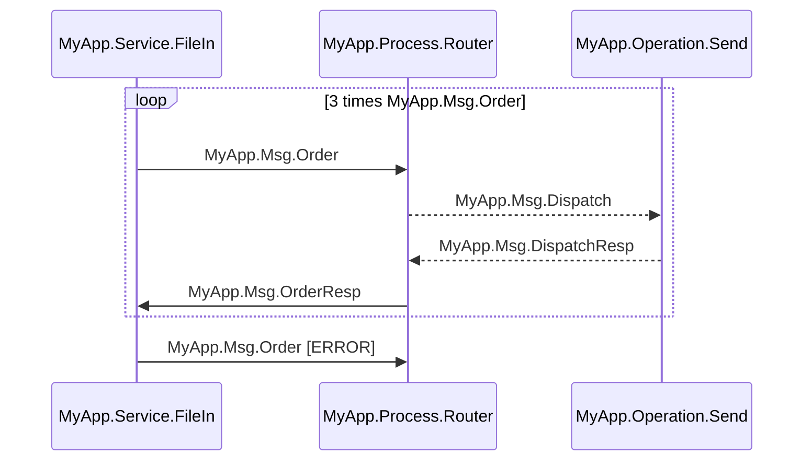

# @iris-mcp/interop

**IRIS Interoperability MCP Server** -- Ensemble/Health Connect production lifecycle, credentials, lookup tables, business rules, data transformations, REST API management, and message forensics (searching message headers and bodies and reading message bodies under the PHI data policy, all reads that are enabled by default) via the Model Context Protocol.

Part of the [IRIS MCP Server Suite](../../README.md).

---

## Installation

```bash
npm install -g @iris-mcp/interop
```

Or run directly without installing:

```bash
npx @iris-mcp/interop
```

---

## Configuration

All servers use the same environment variables:

| Variable | Default | Description |
|----------|---------|-------------|
| `IRIS_HOST` | `localhost` | IRIS hostname or IP |
| `IRIS_PORT` | `52773` | IRIS web server port |
| `IRIS_USERNAME` | `_SYSTEM` | IRIS username |
| `IRIS_PASSWORD` | *(required)* | IRIS password |
| `IRIS_NAMESPACE` | `USER` | Default IRIS namespace |
| `IRIS_HTTPS` | `false` | Use HTTPS instead of HTTP |
| `IRIS_ACCEPT_LANGUAGE` | `en-US,en;q=0.9` | **Optional.** `Accept-Language` header sent on every request, pinning `%Status` error text to a predictable language instead of whatever locale an unspecified header resolves to. IRIS also selects a message table per worker process independently of this header, so localized prefixes can still appear — existing prefix-stripping is unaffected. Details: [suite README](../../README.md#2-set-environment-variables). |
| `IRIS_DATA_POLICY` | *(unset — `redact`)* | **Optional.** `block`, `redact` or `allow` (case-insensitive): the PHI data policy for every profile that no `IRIS_PROFILES` entry sets. Default **`redact`**: `iris_message_body` shows an HL7 v2 body redacted by a reviewed keep-list and withholds every other body, the `preview` action of `iris_message_resend` shows an HL7 v2 body only as its class name and withholds every other body with a reason, and the `body` and `searchTable` actions of `iris_message_search` run and return header rows only. `allow` shows bodies as stored; `block` withholds every body and refuses the `body` and `searchTable` actions, and withholds the Event Log text of `iris_production_logs` and the error text of `iris_message_diagram`. Every one of these is a read, enabled by default. Per profile and in the governance file: see [PHI data policy](#phi-data-policy-iris_data_policy). A malformed value fails startup naming the channel. |

### Multiple servers & the `server` parameter

Optionally, set `IRIS_PROFILES` (a JSON map of named IRIS instances) and `IRIS_GOVERNANCE` (a JSON tool-action policy) to target several instances from one server and restrict which actions are allowed. Every tool accepts an optional `server` parameter (a profile name from `IRIS_PROFILES`) that selects which instance the call targets; omit it to use the `default` profile. It composes with the existing per-call `namespace` override. Both variables are **optional and additive** — omit them and this server behaves exactly as a single-instance, fully-enabled install. Full model, escaping, and worked examples: [Multiple Servers & Governance](../../README.md#multiple-servers--governance).

Optionally, set `IRIS_GOVERNANCE_FILE` to the path of a JSON file of the same shape as `IRIS_GOVERNANCE` to load policy from a file shared across several MCP clients instead of inline JSON. **Optional and additive** — unset (the default) means inert: no file is ever read and behavior is byte-for-byte unchanged. An `IRIS_GOVERNANCE` env value always wins over the file. Details: [Governance file](../../README.md#governance-file-iris_governance_file).

### Tool Visibility (`IRIS_TOOLS_PRESET`)

Set `IRIS_TOOLS_PRESET=core` to trim this server's `tools/list` to a **12-tool runtime roster** (11 package tools + `iris_server_profiles`) — the troubleshoot-a-production loop: status/summary/control, item config, logs/queues/messages, message search, message body, trace diagram, resend. `iris_production_control` stays visible under `core` so the `recover`-first MCP guidance holds under every preset. `IRIS_TOOLS_PRESET=developer` keeps all **25 runtime tools** (24 + `iris_server_profiles`) visible — every tool on this server is already dev-relevant, so `developer` behaves like `full` here. Omit (or set `"full"`) for today's behavior — every tool visible, byte-for-byte. `IRIS_TOOLS_DISABLE`/`IRIS_TOOLS_ENABLE` hide/force-show individual tools independent of the preset. This is orthogonal to `IRIS_GOVERNANCE` above (visibility = does the agent know a tool exists; governance = is an already-visible call allowed). Full model, exact per-tool roster, and the payload-size measurements: [Tool Visibility Presets](../../README.md#tool-visibility-presets). (This server's registered prompts — `recover-stuck-production`, `resend-failed-messages`, `trace-message-flow` and `find-patient-messages` (Story 39.6; it searches for a patient's messages and reads their bodies) — only call tools that stay visible under `core`, so no prompt-pack limitation applies here.)

---

### Audit Logging (`IRIS_AUDIT_LOG`)

For regulated deployments, set `IRIS_AUDIT_LOG=/path/to/audit.jsonl` to record **every MCP tool call this server handles** — success, error, or governance denial — as one secrets-free JSON line (session, sequence, tool, action, outcome, redacted parameter keys). It is **off by default** (unset ⇒ a mechanical no-op, zero filesystem writes) and framework-wide — the same interceptor covers every tool on this server, including the double-gated `iris_message_resend`. `IRIS_AUDIT_LOG_MAX_MB` (default `50`) sets the single-generation rotation size; `IRIS_AUDIT_LOG_PARAMS=true` additionally records (redacted) parameter *values*. Because it is server-side **configuration** — not a governed tool action — an AI client cannot disable its own audit trail; only an operator with server-environment access can. Full record shape, redaction rules, and how it differs from IRIS's own security-audit tools: [Compliance & Auditability](../../README.md#compliance--auditability).

A call to a tool under the PHI data policy (`iris_message_body`, the `body` and `searchTable` actions of `iris_message_search`, and the `preview` action of `iris_message_resend`) also records `dataPolicy` (`{policy, redacted, blocked}`: the policy in force and counts, never body content). So does a call to `iris_production_logs` or `iris_message_diagram`, which are governed under `block`: the entry holds the number of Event Log entries or error warnings withheld under `block`, and 0 counts under `redact` and `allow`. With `IRIS_AUDIT_LOG_PARAMS=true`, the PHI inputs a tool declares (the `filters` of `iris_message_search`) are written as `"[REDACTED]"` under `redact` and `block`, and are logged only under `allow`. Message-body content never reaches the audit file or the console log, under any policy.

### PHI data policy (`IRIS_DATA_POLICY`)

An Interoperability message body can hold protected health information. A per-profile **data policy** controls what this server's tools show of one: `block` withholds every body, `redact` (the **default**) shows an HL7 v2 body redacted by a reviewed keep-list and withholds every other body, and `allow` shows bodies as stored. It governs `iris_message_body`, the `body` and `searchTable` actions of `iris_message_search` (refused under `block`, header rows only otherwise) and the `preview` action of `iris_message_resend`; every one of them is a read, **enabled by default**, so the policy changes what they show and adds no action and no governance key. The `headers` action of `iris_message_search` is outside the policy. `iris_message_diagram` and `iris_production_logs`, both in this server's `core` preset and both reads, enabled by default, are under it only under `block`, which withholds a diagram's error text and each Event Log entry's text with a reason; under `redact` and `allow` they show that text unchanged, because a diagram's error text or an Event Log line can carry segment text that cannot be redacted reliably (see the scope table in [tool_support.md](../../tool_support.md)); where that is not acceptable, restrict them with their governance keys. A field the keep-list keeps still holds what the sender put in it, so a redacted text reduces exposure and is not proof that it holds no identifying value.

**Where to set it.** The first value found wins, for each profile:

1. the `dataPolicy` field of the profile's `IRIS_PROFILES` entry;
2. the `IRIS_DATA_POLICY` environment variable;
3. the governance file's `dataPolicy.profiles.<name>` (`IRIS_GOVERNANCE_FILE`);
4. the governance file's `dataPolicy.global`;
5. `redact`.

`iris_server_profiles` reports each profile's `dataPolicy` and `dataPolicySource` (`IRIS_PROFILES`, `IRIS_DATA_POLICY`, `IRIS_GOVERNANCE_FILE:profiles`, `IRIS_GOVERNANCE_FILE:global` or `default`), so an agent can read the policy before it searches. A call can only tighten the policy, never loosen it: `iris_message_body` takes an optional `dataPolicy` parameter, and a looser value is ignored and reported as `dataPolicyClamped: true`. A malformed value fails startup naming the channel. Full model, the scope over every tool of the suite and the audit fields: [PHI data policy](../../README.md#phi-data-policy).

The data policy reduces exposure of message-body data; it is not a compliance certification.

### Server Manager connections (`IRIS_SERVER_MANAGER`)

Set `IRIS_SERVER_MANAGER=auto` to import IRIS connection definitions straight from the InterSystems Server Manager VS Code extension's `intersystems.servers` settings — one curated roster instead of re-typing host/port/username into every MCP client's config. `IRIS_SERVER_MANAGER` is **framework configuration, not a tool** — it applies identically across all five servers in the suite. Omit (or set `"off"`, the default) for today's behavior: no settings file is ever read. A password-less imported definition is completed via an OS-keychain / `IRIS_CREDENTIAL_HELPER` credential chain (see the [`iris-mcp-credentials` CLI](../../README.md#iris-mcp-credentials-cli) — Server Manager passwords themselves are never readable outside VS Code, by design); `iris_server_profiles` reports where each profile's connection fields came from via `source` (`"env"`/`"server-manager"`) and `sourceFile`. The companion variables are all optional, each with its own default: `IRIS_SM_SERVERS` (unset — import all), `IRIS_SM_SETTINGS_PATHS` (unset — normal discovery), `IRIS_SM_WORKSPACE` (unset — the process CWD) and `IRIS_CREDENTIAL_HELPER` (unset). Full model, discovery precedence, and the SecretStorage boundary explained plainly: [Server Manager connections](../../README.md#server-manager-connections-optional).

## MCP Client Configuration

### Claude Code (`.mcp.json`)

```json
{
  "mcpServers": {
    "iris-interop-mcp": {
      "command": "npx",
      "args": ["-y", "@iris-mcp/interop"],
      "env": {
        "IRIS_HOST": "localhost",
        "IRIS_PORT": "52773",
        "IRIS_USERNAME": "_SYSTEM",
        "IRIS_PASSWORD": "SYS",
        "IRIS_NAMESPACE": "USER"
      }
    }
  }
}
```

### Claude Desktop (`claude_desktop_config.json`)

```json
{
  "mcpServers": {
    "iris-interop-mcp": {
      "command": "npx",
      "args": ["-y", "@iris-mcp/interop"],
      "env": {
        "IRIS_HOST": "localhost",
        "IRIS_PORT": "52773",
        "IRIS_USERNAME": "_SYSTEM",
        "IRIS_PASSWORD": "SYS",
        "IRIS_NAMESPACE": "USER"
      }
    }
  }
}
```

### Cursor

```json
{
  "iris-interop-mcp": {
    "command": "npx",
    "args": ["-y", "@iris-mcp/interop"],
    "env": {
      "IRIS_HOST": "localhost",
      "IRIS_PORT": "52773",
      "IRIS_USERNAME": "_SYSTEM",
      "IRIS_PASSWORD": "SYS",
      "IRIS_NAMESPACE": "USER"
    }
  }
}
```

> **Note:** Replace `"SYS"` with your actual IRIS password. Avoid committing real credentials to version control.

---

## Tool Reference

### Framework Tools

Provided by the shared framework and available on **every** suite server (Epic 19).

| Tool | Description | Key Parameters | Annotations |
|------|-------------|----------------|-------------|
| `iris_server_profiles` | **Call this first.** Reports the configured server-profile roster (non-secret connection metadata — `password` is never included) and the effective governance policy (which actions are enabled/disabled). | `profile?`, `allProfiles?` | readOnly, idempotent |

`iris_server_profiles` is a **read tool, enabled by default**. It reports in-memory config and does not connect to IRIS. Use it to choose the right `server` profile and avoid governance-disabled actions before invoking other tools.

### Production Lifecycle Tools

| Tool | Description | Key Parameters | Annotations |
|------|-------------|----------------|-------------|
| `iris_production_manage` | Create or delete a production; `delete` refuses the namespace's current production unless it is Stopped, accepts only a production class (one that extends `Ens.Production`; any other class is refused and nothing is deleted), and removes an orphan `Ens.Config.Production` row (class gone) with `orphanRemoved: true` | `action`, `name`, `namespace?` | destructive |
| `iris_production_control` | Start, stop, restart, update, recover, or clean | `action`, `name?`, `timeout?`, `force?`, `killAppData?`, `confirm?`, `namespace?` | destructive |
| `iris_production_status` | Get production status with optional detail | `detail?`, `namespace?` | readOnly, idempotent |
| `iris_production_summary` | Cross-namespace production summary | `cursor?` | readOnly, idempotent |

### Production Item & Config Tools

| Tool | Description | Key Parameters | Annotations |
|------|-------------|----------------|-------------|
| `iris_production_item` | Add, remove, enable, disable, get, or set config item settings (set/add accept arbitrary host/adapter settings); `get` reports the item's `production`; enable/disable skip an item whose host class no longer resolves (repair it with `set` + `settings.className` first) | `action`, `itemName`, `className?`, `production?`, `settings?`, `namespace?` | -- |
| `iris_production_autostart` | Get or set auto-start configuration | `action`, `productionName?`, `namespace?` | -- |
| `iris_default_settings_manage` | List, get, set, or delete Interoperability System Default Settings (`Ens.Config.DefaultSettings`) | `action`, `production?`, `item?`, `hostClass?`, `setting?`, `value?`, `description?`, `deployable?`, `namespace?` | destructive |

> **Governance defaults:** the **new write** actions are classified `write` and **disabled by default** under an `IRIS_GOVERNANCE` policy until explicitly allowed — `iris_production_item:add`/`:remove` and `iris_default_settings_manage:set`/`:delete`. The **pre-existing / read** actions are **enabled by default** — `iris_production_item:enable`/`:disable`/`:get`/`:set` (shipped before governance) and `iris_default_settings_manage:list`/`:get`. **Exception — `iris_production_control:clean`** is a new `write` that is nonetheless **enabled by default** (via the `defaultEnabled` marker, Epic 20 decision F2) because it is a recovery operation an operator expects available; it can still be disabled with an explicit `IRIS_GOVERNANCE` override. (A just-`add`-ed config item is not visible to an immediate `get` until the next add/remove/set syncs the config extent from the production class — `set` performs its own sync, so it does see it. See the `iris_production_item` examples below.)

### Production Monitoring Tools

| Tool | Description | Key Parameters | Annotations |
|------|-------------|----------------|-------------|
| `iris_production_logs` | Query event log entries | `type?`, `itemName?`, `count?`, `namespace?` | readOnly, idempotent |
| `iris_production_queues` | Queue status for all production items | `namespace?` | readOnly, idempotent |
| `iris_production_messages` | Trace message flow by session or header ID | `sessionId?`, `headerId?`, `count?`, `namespace?` | readOnly, idempotent |
| `iris_message_diagram` | Mermaid sequence diagram from a message-trace session (Visual Trace as renderable text) | `sessionIds`, `labelMode?`, `maxRows?`, `dedup?`, `namespace?` | readOnly, idempotent |
| `iris_message_search` | Search message headers in a required window of at most 7 days (`headers`), or by what the bodies hold (`body`: structured filters), or by an indexed Search Table value such as an HL7 medical record number (`searchTable`: structured filters over a Search Table class); `body` and `searchTable` are under the PHI data policy: enabled by default, refused under `block` | `action`, `from`, `to?`, `item?`, `source?`, `target?`, `status?`, `sessionId?`, `bodyClass?`, `searchTableClass?`, `filters?`, `errorOnly?`, `limit?`, `cursor?`, `namespace?` | readOnly, idempotent |
| `iris_message_body` | Read the bodies of 1 to 20 messages by header ID, rendered by kind (HL7 v2 as ER7, XML, JSON, text); a read, enabled by default, under the PHI data policy: `redact` shows an HL7 v2 body redacted and withholds every other body | `headerIds`, `maxChars?`, `dataPolicy?`, `namespace?` | readOnly, idempotent |
| `iris_message_resend` | Resend/replay Interoperability messages (`preview` read; `resend`/`resendFiltered` writes) | `action`, `headerIds?`, `item?`, `status?`, `from?`, `to?`, `maxMessages?`, `dryRun?`, `confirm?`, `namespace?` | destructive |
| `iris_production_adapters` | List available adapter types | `category?`, `namespace?` | readOnly, idempotent |

#### `iris_message_diagram` — Message Trace Sequence Diagram

Generates one Mermaid `sequenceDiagram` per requested session — the Management Portal's Visual Trace as renderable text. Config items become participants, `Invocation` maps to arrow style (sync `->>` for Inproc, async `-->>` for Queue), requests are correlated to their responses, errored messages are flagged with an ` [ERROR]` label suffix plus a sanitized `%%` comment, and each diagram opens with a session-metadata header. Two compression tiers keep large traces readable: contiguous identical request/response **pairs** and contiguous identical multi-hop **episodes** each collapse into `loop N times` blocks (episode loops nest pair loops). Anomalies (unpaired messages, correlation conflicts, unknown invocations, errors) surface both as `%%` comments and in the structured `warnings[]` array — generation never fails a call. Use [`iris_production_messages`](#production-monitoring-tools) when you want the raw message rows instead.

> **Governance default:** `iris_message_diagram` is a pure **read** (`mutates: "read"`) and is **enabled by default** under `IRIS_GOVERNANCE`.

> **PHI data policy:** under `block`, each error warning keeps its `Error on message <id>: ` prefix and the rest of its text, in `warnings[]` and in its `%%` line, becomes a fixed reason; the result then carries `dataPolicy`. Under `redact` (the default) and `allow` the diagram is shown unchanged. See [PHI data policy](#phi-data-policy-iris_data_policy).

**Options:**

| Option | Default | Description |
|--------|---------|-------------|
| `sessionIds` | *(required)* | 1–20 positive integer session IDs; one diagram per session |
| `labelMode` | `full` | Arrow label style: `full` = full message body class name; `short` = last dotted segment |
| `maxRows` | `2000` | Per-session cap on loaded message rows (max 10000); the diagram is flagged `truncated` when hit |
| `dedup` | `true` | Collapse identical flows across the requested sessions: a session whose diagram matches an earlier one (session-metadata header and per-message row-id tokens in warning comments normalized) keeps its own entry and reports `dedupOf` = the first session ID with that flow; pass `false` to render every session independently |
| `namespace` | server default | Target namespace for the `Ens.MessageHeader` query |

**Example output** (a session where a repeated 2-hop episode was compressed):



#### `iris_message_search` — Search Message Headers and Bodies

Searches `Ens.MessageHeader` without enabling any write. The `action` enum is fixed: `headers` searches the headers of a required window, `body` searches them by what their message bodies hold (below), and `searchTable` finds them by an indexed Search Table value (below). Rows come back oldest first as header rows only — `id`, `sessionId`, `type`, `status`, `isError`, `sourceItem`, `targetItem`, `bodyClassName`, `bodyId`, UTC ISO 8601 `timeCreated` and `timeProcessed` (each with a `...Raw` sibling that keeps the stored value, and `""` when empty), and `correspondingMessageId` (`null` when none). A row never carries message body content, `ErrorStatus` or `Description`.

> **Governance default:** all three actions (`headers`, `body`, `searchTable`) are pure **reads** (`mutates: "read"`) and are **enabled by default** under `IRIS_GOVERNANCE`, including under the `read-only` preset. Restrict one with, for example, `{"global": {"iris_message_search:headers": false}}`. The tool is in the `core` and `developer` visibility presets. The `body` and `searchTable` actions are also under the PHI data policy (see **Body search** and **Search Table lookup** below): they are refused under `block`. The `headers` action is outside the policy: it returns no Search Table or body value, with one exception, a header with no body class, whose body ID is the literal body. Where header rows are not acceptable, restrict `iris_message_search:headers` with its governance key (a read, enabled by default).

**Options (`headers`):**

| Option | Default | Description |
|--------|---------|-------------|
| `from` | *(required)* | Window start: ISO 8601 with `Z` or an offset (a time with no zone is refused) |
| `to` | now | Window end, in the same form. The window may span at most **7 days**; there is no whole-namespace mode |
| `item` | — | Config item name; matches the source or the target |
| `source`, `target` | — | Source or target config item name |
| `status` | — | `Created`, `Queued`, `Delivered`, `Discarded`, `Suspended`, `Deferred`, `Aborted`, `Errored` or `Completed`; rows report `Errored` as `Error` |
| `sessionId` | — | A positive integer session ID |
| `bodyClass` | — | Message body class name |
| `errorOnly` | — | Only messages whose `IsError` flag is set (not the same as status `Error`) |
| `limit` | `100` | Rows per page, 1 to 500. An **output cap**, not timeout protection: the window is scanned in full, so a wide window on a busy namespace can approach the ~60 s Web Gateway timeout — narrow the window: a filter narrows the rows returned, not the window scanned |
| `cursor` | — | The `nextCursor` of the previous page. Only a page with `hasMore: true` carries one |
| `namespace` | server default | Target namespace |

Every filter is an equality match, not a pattern (`%` and `_` are ordinary characters), bound as a parameter on the IRIS side. The item, source, target and body-class names compare the way `Ens.MessageHeader` stores them: without regard to case, and ignoring trailing blanks and tabs (a trailing line break still counts). When you page a window close to 7 days wide, pass the same `from` and `to` on every page: an omitted `to` is recomputed as now on each call. All three actions check the 7-day bound. A namespace without Interoperability returns `notApplicable: true` with a `reason`, not an error. The `headers` action refuses a `filters` key rather than ignoring it, and `searchTableClass` is refused on `headers` and `body`.

**Body search (`body`):** returns the same header rows for the headers whose message body satisfies structured conditions. It takes the scope options above (`from`, `to`, `item`, `source`, `target`, `status`, `sessionId`, `errorOnly`, `limit`, `cursor`, `namespace`) plus two required ones. It reads the headers in the window first and each body by its ID, so a body filter does not reduce the work (narrow the window instead), and it never returns a body value.

| Option | Description |
|--------|-------------|
| `bodyClass` | **Required.** The exact name of a persistent body class with an SQL table in the namespace (for example `Ens.StringRequest` or `EnsLib.HL7.Message`). Only headers of exactly that class match, so a subclass's bodies are not included |
| `filters` | **Required.** 1 to 10 conditions combined with AND, each `{property, op, value}`. `property` is the exact, case-sensitive name of one property of `bodyClass` (not an SQL column name, not a dotted path). `op` is `eq`, `ne`, `lt`, `le`, `gt`, `ge`, `contains`, `startsWith`, `isNull` or `notNull`. `value` is a string of 1 to 1024 characters, a number or a boolean; leave it out for `isNull` and `notNull` |

`eq`, `ne`, `lt`, `le`, `gt`, `ge` and `startsWith` compare by the property's collation, so a default string property ignores case, while `contains` is a case-sensitive substring test (`%` and `_` are ordinary characters); `ne` never matches a null value. Values are compared in IRIS logical form: a date property takes its day number and a time property its seconds since midnight, not a formatted string; a timestamp property takes its stored text, such as `2001-02-03 08:00:00`, not an ISO 8601 `T` form; a number is sent in IRIS canonical form (`0.5` becomes `.5`), so give a text property a string. A header whose body no longer exists never matches. On `EnsLib.HL7.Message`, `RawContent` holds only the first 10,000 characters of the message, so a search on it does not see later text (a large message with an embedded report, for example). A stream property accepts only `isNull` and `notNull`. A property that has no column is refused: a list or array collection, an embedded (serial) object, a relationship, a multidimensional property, and a transient or calculated property that is not SQL-computed. The property, the operator and the table are resolved from the class dictionary on the IRIS side and every value is bound as a parameter, so nothing a caller sends becomes SQL text; a refusal names the parameter (for example `filters[2].op`) and never the value.

> **Data policy:** the `body` action is under the PHI data policy (`IRIS_DATA_POLICY`, set per profile; default `redact`) and is a read, **enabled by default**. Under `block` it is refused with `DATA_POLICY_BLOCKED` and no IRIS call, because a body search reveals what the bodies hold; use `headers`, or ask the operator for a looser policy for the profile. Under `redact` and `allow` it runs, the result carries `dataPolicy` (`{policy, redacted: 0, blocked: 0}`) and one trailing line names the policy; which headers match still shows what the bodies hold, so where that is not acceptable use `block` or restrict `iris_message_search:body` with its governance key. And the audit log (`IRIS_AUDIT_LOG_PARAMS`) writes `filters` as `"[REDACTED]"` under `redact` and `block`. The data policy reduces exposure of message-body data; it is not a compliance certification.

**Search Table lookup (`searchTable`):** returns the same header rows for the headers whose message has the Search Table entries that structured conditions ask for, such as the HL7 messages of one medical record number. It takes the scope options above (`from`, `to`, `item`, `source`, `target`, `status`, `sessionId`, `errorOnly`, `limit`, `cursor`, `namespace`) plus the options below, reads the headers in the window first and probes the Search Table by each header's body ID (so a Search Table filter does not reduce the work: narrow the window instead), and never returns a Search Table or body value. It is a read, **enabled by default**.

| Option | Description |
|--------|-------------|
| `searchTableClass` | **Required.** The exact name of a compiled virtual-document Search Table class in the namespace, such as `EnsLib.HL7.SearchTable`. A custom Search Table (an `Ens.CustomSearchTable` subclass, which has no configured properties), an abstract base, a document class and a name that is not an exact, compiled class are refused |
| `filters` | **Required.** 1 to 10 conditions combined with AND, each `{property, op, value}`, with the operators and value rules of `body` (a value is at most 256 characters here: the Search Table stores no more). `property` is the exact, case-sensitive name of a property that the class defines or inherits from its Search Table superclasses; an unknown one is refused with an error that lists the class's configured property names |
| `bodyClass` | Optional. The exact name of a compiled class that is, or extends, the Search Table's document class; it replaces that class as the header class to match |

`EnsLib.HL7.SearchTable` has `MSHTypeName` (MSH-9 as `ADT_A01`), `MSHControlID` (MSH-10), `PatientID` (PID-2, every PID-3 repetition and PID-4: use it for a medical record number), `PatientName` (PID-5) and `PatientAcct` (PID-18). A message matches `eq`, `lt`, `le`, `gt`, `ge`, `contains` or `startsWith` when it has at least one non-empty entry for the property whose stored value satisfies it, so a multi-valued property matches on any of its values. `ne` matches when the message has no entry equal to the value (not when some entry differs), a message that was never indexed included, `isNull` when it has no non-empty entry (a message that was never indexed included) and `notNull` when it has at least one. Values are normalized as the Search Table stores them: a default property ignores case (give the value in any case), a `String:CaseSensitive` property such as `MSHControlID` compares exactly, an Integer, Numeric or Boolean property accepts only `eq`, `ne`, `isNull` and `notNull` with its value normalized (`0007` is `7`), and a `|` is stored as `+`. Only headers of the Search Table's document class match (`EnsLib.HL7.Message` for `EnsLib.HL7.SearchTable`), because its entries are keyed by that class's IDs. A Search Table holds only the messages indexed when they were processed (or rebuilt with `BuildIndex`), so no match does not prove that no message holds the value. A namespace with no Search Table property returns `notApplicable: true` with a `reason`, checked before the class. The class, the properties (as PropIds), the operators and the table are resolved on the IRIS side and every value is bound as a parameter, so nothing a caller sends becomes SQL text; a refusal names the parameter (for example `filters[1].property`) and never the value.

> **Data policy:** the `searchTable` action is under the PHI data policy (`IRIS_DATA_POLICY`, set per profile; default `redact`) and is a read, **enabled by default**. Under `block` it is refused with `DATA_POLICY_BLOCKED` and no IRIS call, because a Search Table lookup reveals values taken from message bodies; use `headers`, or ask the operator for a looser policy for the profile. Under `redact` and `allow` it runs, the result carries `dataPolicy` (`{policy, redacted: 0, blocked: 0}`) and one trailing line names the policy; which headers match still shows what the bodies hold, so where that is not acceptable use `block` or restrict `iris_message_search:searchTable` with its governance key. And the audit log (`IRIS_AUDIT_LOG_PARAMS`) writes `filters` as `"[REDACTED]"` under `redact` and `block`. The data policy reduces exposure of message-body data; it is not a compliance certification.

#### `iris_message_body` — Read Message Bodies

Reads the bodies of 1 to 20 messages by header ID, such as the `id` values `iris_message_search` returns: use it after a search to see what a message carried. It is a read (`mutates: "read"`) and **enabled by default** under `IRIS_GOVERNANCE`, including under the `read-only` preset; it is one governance key, which an operator restricts with `{"global": {"iris_message_body": false}}`. It is in the `core` and `developer` visibility presets, and always visible together with `iris_message_search`.

| Option | Default | Description |
|--------|---------|-------------|
| `headerIds` | *(required)* | 1 to 20 header IDs, each a positive integer or a string of digits. The items come back in request order, one per ID, duplicates included; a header that does not exist is `{id, found: false, error: "Header <id> not found"}` |
| `maxChars` | `10000` | The most characters of text shown per body, 1 to 1048576. An **output cap** on the text the tool returns: a longer text is cut, with `truncated: true`, never between the two halves of a surrogate pair. An XML body is serialized whole before it is cut, and so is a JSON export, but a character stream in a property dump is read only up to the read limit |
| `dataPolicy` | — | `block`, `redact` or `allow`. It can only **tighten** the profile's policy: a looser value is ignored and the result says so (`dataPolicyClamped: true` and one trailing line) |
| `namespace` | server default | Target namespace |

Each body is rendered by its kind, which comes from the body class and never from its content:

| Body | Shown as | `format` |
|------|----------|----------|
| HL7 v2 (`EnsLib.HL7.Message`) | The complete ER7 text; a batch with all its children | `er7` |
| XML virtual document (`EnsLib.EDI.XML.Document`) | The XML text | `xml` |
| Another persistent object | JSON: the `%JSONExportToStream` output when its class extends `%JSON.Adaptor`, otherwise a dump of its public properties (a character stream shows its text and a binary stream its class and size; a list or array is its count; private, internal, calculated, transient and multidimensional properties are left out) | `json` |
| Stream or stream container | The stream's text | `text` |
| A header with no body class | The header's body ID, which is the value; a header with no body ID either has no body, and is not shown (`bodyPolicy` `none`, with that reason) | `text` |
| Anything else (X12, EDIFACT or another virtual document, a class that is not compiled, a body that no longer opens) | Not shown: `notShown` gives the reason | none |

An HL7 v2 body is **read only whole**: IRIS never cuts one, so a body longer than 65536 characters is not shown, with the reason (a body that IRIS reads whole is still cut at `maxChars` like any other text). Under `allow`, a larger `maxChars` (at most 1048576) raises that limit and reads a longer one whole; a body longer than 1048576 characters is never shown. Each found item is `{id, found: true, bodyClassName, bodyId, bodyKind, bodyPolicy}` plus either `format`, `text` and `truncated`, or `notShown`. A text is sanitized after redaction and before the cut: CRLF and a lone CR become LF (an ER7 segment is one line), and every other C0 control character except TAB and LF, and DEL, becomes U+FFFD. A namespace without Interoperability returns `notApplicable: true` with a `reason`, not an error.

> **Data policy:** the tool is under the PHI data policy (`IRIS_DATA_POLICY`, set per profile; default `redact`), and the request names which bodies IRIS may read at all. Under `redact` IRIS returns the text of HL7 v2 bodies only, and the tool applies a reviewed keep-list to the complete text: every field that is not on the list is replaced by `***`, and a text the engine cannot read is withheld. Every other body, and an HL7 v2 body over 65536 characters, is withheld with a reason in `notShown`, and no other body's content leaves IRIS. Under `block` every body is withheld and IRIS returns the text of none (IRIS opens each body only to report whether it can be read). Under `allow` each body is shown as stored. Each body carries `bodyPolicy` (`redacted`, `blocked` or `none`), and the result carries `dataPolicy` (`{policy, redacted, blocked}`) and a trailing line `Data policy <policy>: <n> redacted, <n> withheld.` Neither the audit log nor the console log holds body text under any policy. The data policy reduces exposure of message-body data; it is not a compliance certification.

#### `iris_message_resend` — Resend / Replay Messages

Resends messages via the pinned `Ens.MessageHeader:ResendDuplicatedMessage` API (the same call the Management Portal's "Resend" button uses). Three actions:

- **`preview`** (read) — per header ID (1–100): id, session, source/target item, status, time, body classname (+ existence check), a first-~1KB body summary under the operator's data policy, and a resendability verdict + reason (a Request-type `Status=Error` header is the correct retry target; a Response-type error header is flagged as likely a no-op). Never mutates.

  > **Data policy:** the body summary follows the profile's `dataPolicy` (`IRIS_DATA_POLICY`, an `IRIS_PROFILES` entry's `dataPolicy`, or the governance file; default **`redact`**). Under `redact` an HL7 v2 body shows only its class name (`(non-stream body; class=EnsLib.HL7.Message)`) and every other body, a stream included, is withheld with a reason (`bodySummary` is `""`); `block` withholds every body; `allow` returns the summary as before, field for field. A header with no readable body (a missing class, a literal body, a body that does not open) reports `bodyPolicy: {outcome: "none"}`. Under `redact` and `block` each found item carries `bodyKind` and `bodyPolicy`, and the result carries `dataPolicy: {policy, redacted, blocked}`; under `allow` none of these fields appears. `iris_server_profiles` reports each profile's `dataPolicy`. See the suite README's [PHI data policy](../../README.md#phi-data-policy). The data policy reduces exposure of message-body data; it is not a compliance certification.
- **`resend`** (write) — resend up to 100 explicit `headerIds` directly. Per-header result `{originalId, newHeaderId?, ok, error?}`; a bad header does not abort the batch.
- **`resendFiltered`** (write) — resend messages matching `item` (required — matches source or target config item) + `status` (default `'Errored'`) + a `from`/`to` time window (required `from`, max 7 days). **Dry-run-first**: `dryRun` defaults to `true` and returns only the match count + a first-20 sample, resending NOTHING; executing requires **both** `dryRun:false` AND `confirm:true`, otherwise the call is refused with no changes made. `maxMessages` caps the batch (default 100, hard cap 500) — a match count over the cap is refused (not truncated-and-executed).

> **DUPLICATION HAZARD:** resending an already-processed message delivers its data again downstream — the target sees a brand-new message, not a correction. Always `preview` first and confirm the message is genuinely worth retrying.

**Governance:** `preview` is a **read, enabled by default**. `resend` and `resendFiltered` are truthfully classified `write` and are **DEFAULT-DISABLED** — unlike `iris_production_control:clean` (Epic 20), resend is NOT given `defaultEnabled`, because it duplicates business data flow downstream rather than recovering a wedged production. Enable via `IRIS_GOVERNANCE`:

```json
{"global": {"iris_message_resend:resend": true, "iris_message_resend:resendFiltered": true}}
```

**Input (resendFiltered, dry run):**
```json
{
  "action": "resendFiltered",
  "item": "MyApp.Operation.Send",
  "from": "2026-07-01T00:00:00Z"
}
```

**Output (dry run):**
```json
{
  "action": "resendFiltered",
  "dryRun": true,
  "matchCount": 3,
  "sample": [
    { "id": 90412, "sourceItem": "MyApp.Service.FileIn", "targetItem": "MyApp.Operation.Send", "status": "Errored", "timeCreated": "2026-07-01T10:30:00.000Z" },
    { "id": 90418, "sourceItem": "MyApp.Service.FileIn", "targetItem": "MyApp.Operation.Send", "status": "Errored", "timeCreated": "2026-07-01T14:05:12.441Z" },
    { "id": 90427, "sourceItem": "MyApp.Service.FileIn", "targetItem": "MyApp.Operation.Send", "status": "Errored", "timeCreated": "2026-07-02T09:11:03.907Z" }
  ],
  "item": "MyApp.Operation.Send",
  "status": "Errored",
  "from": "2026-07-01T00:00:00Z",
  "to": "2026-07-02T10:30:00.000Z",
  "maxMessages": 100
}
```

Executing requires the same call again with `dryRun: false, confirm: true` (or `action: "resend"` with an explicit `headerIds` list for a small known set).

### Credential Tools

| Tool | Description | Key Parameters | Annotations |
|------|-------------|----------------|-------------|
| `iris_credential_manage` | Create, update, or delete credentials | `action`, `id`, `username?`, `password?`, `namespace?` | destructive |
| `iris_credential_list` | List all credentials (passwords never returned) | `namespace?` | readOnly, idempotent |

### Lookup Table Tools

| Tool | Description | Key Parameters | Annotations |
|------|-------------|----------------|-------------|
| `iris_lookup_manage` | Get, set, or delete lookup table entries | `action`, `tableName`, `key`, `value?`, `namespace?` | destructive |
| `iris_lookup_transfer` | Export or import lookup tables as XML | `action`, `tableName`, `xml?`, `namespace?` | destructive |

### Business Rule Tools

| Tool | Description | Key Parameters | Annotations |
|------|-------------|----------------|-------------|
| `iris_rule_list` | List all business rule classes | `prefix?`, `filter?`, `cursor?`, `pageSize?`, `namespace?` | readOnly, idempotent |
| `iris_rule_get` | Get full rule definition with conditions and actions | `name`, `namespace?` | readOnly, idempotent |

**`iris_rule_list` filtering and pagination:**

- `prefix` — only include rules whose name starts with this string (e.g., `"MyPackage.Rules"`).
- `filter` — case-insensitive substring match (e.g., `"routing"` matches `"MyApp.Rules.RoutingRule"` and `"myapp.rules.routingvalidation"`).
- `cursor` / `pageSize` — paginate large result sets; `nextCursor` is returned when more pages exist.

### Data Transformation Tools

| Tool | Description | Key Parameters | Annotations |
|------|-------------|----------------|-------------|
| `iris_transform_list` | List all DTL transform classes | `prefix?`, `filter?`, `cursor?`, `pageSize?`, `namespace?` | readOnly, idempotent |

**`iris_transform_list` filtering and pagination:**

- `prefix` — only include transforms whose name starts with this string (e.g., `"MyPackage.Transforms"`).
- `filter` — case-insensitive substring match (e.g., `"hl7"` matches `"HL7toSDA"` and `"hl7convert"`).
- `cursor` / `pageSize` — paginate large result sets; `nextCursor` is returned when more pages exist.
| `iris_transform_test` | Execute a transformation against sample input | `className`, `sourceClass`, `sourceData?`, `namespace?` | idempotent |

### REST API Tools

| Tool | Description | Key Parameters | Annotations |
|------|-------------|----------------|-------------|
| `iris_interop_rest` | Create, delete, or get a REST application (`name` is a package name, e.g. `MyApi`) | `action`, `name`, `spec?`, `namespace?` | destructive |

---

## Prompts

Workflow-shaped [MCP prompts](../../README.md#workflow-prompts--agent-skills) (Epic 25) served via `prompts/list`/`prompts/get`. Prompts are a separate protocol capability from tools — they carry no governance key and do not change this server's tool count.

| Prompt | Description |
|---|---|
| `trace-message-flow` | Traces a message's flow through a production: `iris_production_messages` for the hops, `iris_message_search` (`headers`, in a window of at most 7 days) for the header rows, `iris_message_body` for the bodies that matter under the PHI data policy (a withheld body's reason is reported, never read another way), `iris_message_diagram` for the sequence diagram, and `iris_production_logs` for any erroring items (under `block`, the reason for withheld diagram error text and Event Log text is reported the same way, never read another way). Its name, title and arguments are unchanged (`sessionOrHeaderId` required, `namespace` optional). Every tool it calls is in the `core` preset, and each is a read that is enabled by default, except the recovery it may recommend (`iris_production_control` action `recover`, a write that is enabled by default), which it never runs without the user's confirmation. |
| `recover-stuck-production` | Diagnoses and recovers a troubled/wedged production, following the recover-first, clean-last-resort escalation ladder — never suggests `killAppData` without the user's explicit acceptance of persistent business-state loss. Under the `block` data policy it reports the reason for withheld Event Log text and never reads that text another way. |
| `resend-failed-messages` | Resends failed messages for a config item using the dry-run-first `iris_message_resend` workflow — preview the match count, review with the user, execute only on explicit approval, then verify the new headers. States the duplication hazard and that the write actions are default-disabled. |
| `find-patient-messages` | Finds a patient's messages by a Search Table value such as a medical record number (`patientId` required; `from`, `to`, `searchTableClass` and `namespace` optional). It reads the profile's data policy with `iris_server_profiles`, asks for a window of at most 7 days, looks the patient up with `iris_message_search` (`searchTable`, `PatientID`), lists the header rows, and reads bodies with `iris_message_body` only when the user wants content, under the PHI data policy. Its main path is in the `core` preset. It reads only: `iris_message_search:searchTable` and `iris_message_body` are reads, enabled by default. A withheld body stays withheld: the prompt never loosens the policy and never reads a body another way. |

Also installable as [Agent Skills](../../skills/README.md).

---

## Tool Examples

<details>
<summary><strong>iris_production_manage</strong> -- Create a production</summary>

`create` produces an **empty production** (no config items). The new production class extends `Ens.Production` with a minimal `XData ProductionDefinition` block. To add services, processes, or operations use `iris_production_item` afterward, or edit the class directly.

**Input:**
```json
{
  "action": "create",
  "name": "MyApp.Production",
  "namespace": "USER"
}
```

**Output:**
```json
{
  "action": "created",
  "name": "MyApp.Production"
}
```
</details>

<details>
<summary><strong>iris_production_control</strong> -- Start a production</summary>

Six actions (`start`, `stop`, `restart`, `update`, `recover`, `clean`) are verified to work. `start` and `restart` require `name`; the others do not.

`clean` clears a **stopped** production's stale runtime state (queues, job-status, suspended messages) to unwedge a production that `recover` cannot fix. For a troubled production, prefer `recover` first; use `clean` only as a **last resort**. By default `clean` touches only transient runtime state; setting `killAppData: true` (with `confirm: true`) **also** wipes the persistent `^Ens.AppData` business state — HL7 sequence numbers, file/FTP done-file tables (→ duplicate re-ingestion), and RecordMap/X12 batch/control state. `killAppData: true` without `confirm: true` is refused and changes nothing.

**Governance:** `start`/`stop`/`restart`/`update`/`recover` are grandfathered (always enabled). `clean` is a **write but enabled by default** (via the `defaultEnabled` marker, Epic 20 decision F2) — a recovery operation an operator expects available — while remaining truthfully `mutates: "write"`. An operator can still disable it with an explicit `IRIS_GOVERNANCE` override (e.g. `{"global":{"iris_production_control:clean":false}}`).

**Input:**
```json
{
  "action": "start",
  "name": "MyApp.Production"
}
```

**Output:**
```json
{
  "action": "start",
  "name": "MyApp.Production",
  "status": "Running"
}
```

**Clean (transient-only) input/output:**
```json
{ "action": "clean" }
```
```json
{ "action": "cleaned", "killAppData": 0 }
```
</details>

<details>
<summary><strong>iris_production_status</strong> -- Get production status</summary>

**Input:**
```json
{
  "detail": true,
  "namespace": "USER"
}
```

**Output:**
```json
{
  "name": "MyApp.Production",
  "state": "Running",
  "stateCode": 1,
  "items": [
    { "name": "MyApp.Service.FileIn", "className": "MyApp.Service.FileIn", "enabled": true, "adapter": "EnsLib.File.InboundAdapter" }
  ]
}
```
</details>

<details>
<summary><strong>iris_production_summary</strong> -- Cross-namespace summary</summary>

**Input:**
```json
{}
```

**Output:**
```json
{
  "productions": [
    { "namespace": "USER", "name": "MyApp.Production", "state": "Running", "stateCode": 1 },
    { "namespace": "HSLIB", "name": "HS.Production", "state": "Stopped", "stateCode": 2 }
  ],
  "count": 2
}
```
</details>

<details>
<summary><strong>iris_production_item</strong> -- Get config item settings</summary>

**Input:**
```json
{
  "action": "get",
  "itemName": "MyApp.Service.FileIn"
}
```

**Output:**
```json
{
  "itemName": "MyApp.Service.FileIn",
  "production": "MyApp.Production",
  "className": "MyApp.Service.FileIn",
  "enabled": true,
  "settings": {
    "FilePath": "/data/incoming",
    "FileSpec": "*.txt"
  }
}
```

`Ens.Config.Item` is keyed by the composite pair `(production, name)`, not `name` alone. `get` and `set` both accept an optional `production` to resolve the item unambiguously when the same `itemName` exists in more than one production; when omitted, `get` resolves the first matching row and its `production` field tells you which production's item that was (the field is present whether or not you passed `production`), and `set` defaults to the namespace's active production (same default `add`/`remove` already use — required when no production is active).

**`set` persistence and side effects.** `set` writes both the `Ens.Config.Item` SQL extent (so an immediate `get` sees the change) and the production **class** XData via `SaveToClass` (so the change survives the next `add`/`remove`/`set` resync or a class recompile). Consequences worth knowing:

- A `set` that changes nothing (`settings: {}`) performs no write at all and does not touch the running production.
- `set` rejects a `settings.className` that is not a compiled, non-abstract `Ens.Host` subclass. Persisting an invalid host class would be swallowed silently by `SaveToClass`'s `OnConfigChange` handling and leave a broken item, so this is a rejection rather than a warning. The same guard applies to `add`'s `className` argument **and** to an `add` `settings.className` override.
- `set` refreshes the running production (`Ens.Director.UpdateProduction`) only when the production it wrote is the one currently running — editing a stopped production never disturbs a different, running one.
- `set` rewrites the production class definition on the server. If your production classes are source-controlled, expect drift against the checked-in `.cls` after a `set`.
</details>

<details>
<summary><strong>iris_production_item</strong> -- Add a config item with an arbitrary adapter setting</summary>

**Input:**
```json
{
  "action": "add",
  "production": "MyApp.FHIRProduction",
  "itemName": "MyApp.Service.FileIn",
  "className": "EnsLib.File.PassthroughService",
  "settings": {
    "comment": "inbound file feed",
    "FilePath": "/data/incoming"
  }
}
```

Property keys (`poolSize`, `enabled`, `comment`, `category`, `className`) map to `Ens.Config.Item` properties; any other key (e.g. `FilePath`) routes to an `Ens.Config.Setting` (Target `Adapter` by default; suffix a key with `@Host` or `@Adapter` to force the target). Use `"action": "remove"` with `itemName` (and `production`) to remove an item.

**Output:**
```json
{
  "action": "added",
  "itemName": "MyApp.Service.FileIn",
  "production": "MyApp.FHIRProduction",
  "className": "EnsLib.File.PassthroughService",
  "updatedSettings": ["comment", "FilePath"]
}
```
</details>

<details>
<summary><strong>iris_default_settings_manage</strong> -- Set a System Default Setting</summary>

**Input:**
```json
{
  "action": "set",
  "production": "MyApp.FHIRProduction",
  "item": "MyApp.Service.FileIn",
  "hostClass": "EnsLib.File.PassthroughService",
  "setting": "FilePath",
  "value": "/data/incoming",
  "deployable": true
}
```

Each key slot (`production` / `item` / `hostClass` / `setting`) defaults to `*` (= applies to all) when omitted. `list` and `get` are read actions; `set` and `delete` are write actions, opt-in under tool governance (disabled by default).

**Output:**
```json
{
  "action": "set",
  "production": "MyApp.FHIRProduction",
  "item": "MyApp.Service.FileIn",
  "hostClass": "EnsLib.File.PassthroughService",
  "setting": "FilePath",
  "value": "/data/incoming"
}
```
</details>

<details>
<summary><strong>iris_production_autostart</strong> -- Get auto-start config</summary>

**Input:**
```json
{
  "action": "get"
}
```

**Output:**
```json
{
  "productionName": "MyApp.Production",
  "enabled": true
}
```
</details>

<details>
<summary><strong>iris_production_logs</strong> -- Query event logs</summary>

**Input:**
```json
{
  "type": "Error",
  "count": 10
}
```

**Output:**
```json
{
  "entries": [
    { "id": 8, "timestamp": "2026-04-07 10:30:00.123", "type": 2, "itemName": "MyApp.Operation.SendEmail", "text": "SMTP connection timeout", "sourceClass": "EnsLib.EMail.OutboundAdapter", "sourceMethod": "SendMail", "sessionId": 1234 }
  ],
  "count": 1
}
```

`sourceClass`, `sourceMethod` and `sessionId` appear only when the entry holds a value. `type` takes a display name, so `Error` returns the entries whose `type` is 2 (a read, enabled by default).
</details>

<details>
<summary><strong>iris_production_queues</strong> -- Queue status</summary>

**Input:**
```json
{}
```

**Output:**
```json
{
  "queues": [
    { "itemName": "MyApp.Service.FileIn", "count": 0 },
    { "itemName": "MyApp.Process.Router", "count": 3 }
  ]
}
```
</details>

<details>
<summary><strong>iris_production_messages</strong> -- Trace messages</summary>

**Input:**
```json
{
  "sessionId": 12345
}
```

**Output:**
```json
{
  "messages": [
    { "headerId": 12345, "source": "MyApp.Service.FileIn", "target": "MyApp.Process.Router", "messageClass": "Ens.StringRequest", "timestamp": "2026-04-07 10:30:00", "status": "Completed" }
  ]
}
```
</details>

<details>
<summary><strong>iris_message_diagram</strong> -- Diagram a message trace</summary>

**Input:**
```json
{
  "sessionIds": [12345, 12346],
  "labelMode": "short",
  "dedup": true
}
```

**Output** (`structuredContent`; `content` carries one summary line + fenced ```` ```mermaid ```` block per session):
```json
{
  "diagrams": [
    { "sessionId": 12345, "mermaid": "sequenceDiagram\n%% Session 12345: ...", "messageCount": 14, "warnings": [], "truncated": false },
    { "sessionId": 12346, "mermaid": "sequenceDiagram\n%% Session 12346: ...", "messageCount": 14, "warnings": [], "truncated": false, "dedupOf": 12345 }
  ],
  "count": 2
}
```
</details>

<details>
<summary><strong>iris_message_search</strong> -- Find a patient's messages by a Search Table value</summary>

The `searchTable` action finds the messages whose indexed Search Table entry equals a value, here a medical record number (`PatientID` covers PID-2, every PID-3 repetition and PID-4 of `EnsLib.HL7.SearchTable`). It is a read, enabled by default, and under the PHI data policy: the default `redact` runs it and `block` refuses it with `DATA_POLICY_BLOCKED`. `from` is required and the window spans at most 7 days. The result holds header rows only, with no Search Table value and no body text. The output below was captured from the built server on a synthetic fixture namespace under the default `redact` policy.

**Input:**
```json
{
  "action": "searchTable",
  "namespace": "EXECMCPTMP396A",
  "from": "2001-02-03T11:59:00Z",
  "to": "2001-02-03T12:01:00Z",
  "searchTableClass": "EnsLib.HL7.SearchTable",
  "filters": [{ "property": "PatientID", "op": "eq", "value": "SYNTHPHI396-MRN-P" }]
}
```

**Output** (`structuredContent`, trimmed):
```json
{
  "action": "searchTable",
  "rows": [
    { "id": 1, "sessionId": 396001, "type": "Request", "status": "Completed", "isError": false, "sourceItem": "Story396.Service", "targetItem": "Story396.Router", "bodyClassName": "EnsLib.HL7.Message", "bodyId": "1", "timeCreated": "2001-02-03T12:00:01.000Z", "timeCreatedRaw": "2001-02-03 12:00:01", "timeProcessed": "", "timeProcessedRaw": "", "correspondingMessageId": null },
    { "id": 2, "sessionId": 396001, "type": "Request", "status": "Completed", "isError": false, "sourceItem": "Story396.Router", "targetItem": "Story396.Operation", "bodyClassName": "EnsLib.HL7.Message", "bodyId": "1", "…": "…" },
    { "id": 3, "sessionId": 396002, "type": "Request", "status": "Completed", "isError": false, "sourceItem": "Story396.Service", "targetItem": "Story396.Router", "bodyClassName": "EnsLib.HL7.Message", "bodyId": "2", "…": "…" }
  ],
  "hasMore": false,
  "limit": 100,
  "from": "2001-02-03T11:59:00.000Z",
  "fromRaw": "2001-02-03 11:59:00",
  "to": "2001-02-03T12:01:00.000Z",
  "toRaw": "2001-02-03 12:01:00",
  "dataPolicy": { "policy": "redact", "redacted": 0, "blocked": 0 }
}
```
</details>

<details>
<summary><strong>iris_message_body</strong> -- Read message bodies under the redact policy</summary>

Reads the bodies of the messages `iris_message_search` found, by header ID. It is a read, enabled by default, and under the PHI data policy. Under the default `redact` an HL7 v2 body is shown only after a reviewed keep-list redaction: a field nobody reviewed is replaced by `***`. Every other kind of body is withheld with a reason in `notShown`, and the content of a withheld body is never read out of IRIS. The output below was captured from the built server on a synthetic fixture namespace; the code `KEEPME396-CODE` is a field the keep-list keeps, and the identifying values were replaced.

**Input:**
```json
{
  "namespace": "EXECMCPTMP396A",
  "headerIds": [1, 2, 3]
}
```

**Output** (`structuredContent`, trimmed):
```json
{
  "items": [
    {
      "id": 1,
      "found": true,
      "bodyClassName": "EnsLib.HL7.Message",
      "bodyId": "1",
      "bodyKind": "hl7v2",
      "bodyPolicy": { "outcome": "redacted", "redactedFields": 6 },
      "format": "er7",
      "text": "MSH|^~\\&|***|***|||***||ADT^A01|***|P|2.5.1\nPID|1||***\nOBX|1|TX|KEEPME396-CODE^KEEPME396-TEXT^L||***\n",
      "truncated": false
    },
    { "id": 2, "found": true, "…": "…" },
    { "id": 3, "found": true, "…": "…" }
  ],
  "count": 3,
  "maxChars": 10000,
  "dataPolicy": { "policy": "redact", "redacted": 3, "blocked": 0 }
}
```
</details>

<details>
<summary><strong>iris_production_adapters</strong> -- List adapters</summary>

**Input:**
```json
{
  "category": "inbound"
}
```

**Output:**
```json
{
  "adapters": [
    { "name": "EnsLib.File.InboundAdapter", "category": "inbound" },
    { "name": "EnsLib.HTTP.InboundAdapter", "category": "inbound" },
    { "name": "EnsLib.SQL.InboundAdapter", "category": "inbound" }
  ]
}
```
</details>

<details>
<summary><strong>iris_credential_manage</strong> -- Create a credential</summary>

**Input:**
```json
{
  "action": "create",
  "id": "SMTP-Relay",
  "username": "notifications@myapp.com",
  "password": "smtp-secret-123"
}
```

**Output:**
```json
{
  "action": "create",
  "id": "SMTP-Relay",
  "status": "created"
}
```
</details>

<details>
<summary><strong>iris_credential_list</strong> -- List credentials</summary>

**Input:**
```json
{}
```

**Output:**
```json
{
  "credentials": [
    { "id": "SMTP-Relay", "username": "notifications@myapp.com" }
  ],
  "count": 1
}
```
</details>

<details>
<summary><strong>iris_lookup_manage</strong> -- Set a lookup entry</summary>

**Input:**
```json
{
  "action": "set",
  "tableName": "EmailRouting",
  "key": "support",
  "value": "support@myapp.com"
}
```

**Output:**
```json
{
  "action": "set",
  "tableName": "EmailRouting",
  "key": "support",
  "value": "support@myapp.com"
}
```
</details>

<details>
<summary><strong>iris_lookup_transfer</strong> -- Export lookup table</summary>

**Input:**
```json
{
  "action": "export",
  "tableName": "EmailRouting"
}
```

**Output:**
```json
{
  "xml": "<lookupTable name=\"EmailRouting\"><entry key=\"support\" value=\"support@myapp.com\"/></lookupTable>"
}
```
</details>

<details>
<summary><strong>iris_rule_list</strong> -- List business rules</summary>

**Input:**
```json
{}
```

**Output:**
```json
{
  "rules": ["MyApp.Rules.MessageRouting", "MyApp.Rules.ErrorHandling"],
  "count": 2
}
```
</details>

<details>
<summary><strong>iris_rule_get</strong> -- Get rule definition</summary>

**Input:**
```json
{
  "name": "MyApp.Rules.MessageRouting"
}
```

**Output:**
```json
{
  "name": "MyApp.Rules.MessageRouting",
  "content": "Class MyApp.Rules.MessageRouting Extends Ens.Rule.Definition\n{\nXData RuleDefinition [ XMLNamespace = \"http://www.intersystems.com/rule\" ]\n{\n<ruleDefinition>...</ruleDefinition>\n}\n}"
}
```
</details>

<details>
<summary><strong>iris_transform_list</strong> -- List DTL transforms</summary>

**Input:**
```json
{}
```

**Output:**
```json
{
  "transforms": ["MyApp.Transforms.InputToCanonical", "MyApp.Transforms.CanonicalToHL7"],
  "count": 2
}
```
</details>

<details>
<summary><strong>iris_transform_test</strong> -- Test a transformation</summary>

**Input:**
```json
{
  "className": "MyApp.Transforms.InputToCanonical",
  "sourceClass": "MyApp.Messages.InputMessage",
  "sourceData": { "PatientName": "Smith,John", "DOB": "1990-01-15" }
}
```

**Output (target extends `%JSON.Adaptor`):**
```json
{
  "className": "MyApp.Transforms.InputToCanonical",
  "sourceClass": "MyApp.Messages.InputMessage",
  "output": {
    "className": "MyApp.Messages.CanonicalMessage",
    "serialization": "json-adaptor",
    "data": {
      "Name": "John Smith",
      "DateOfBirth": "1990-01-15"
    }
  }
}
```

**Output (target does not extend `%JSON.Adaptor` — e.g., most `Ens.*` internal classes):**

The response falls back to a best-effort reflection over the target's public non-calculated non-relationship properties. `data` is a real object of property values (object-valued properties are rendered as `[object <ClassName>]` placeholders), and a `note` explains the caveat. Use the `serialization` field to branch on which mode was used.

```json
{
  "className": "Ens.SSH.InteractiveAuth.DTL",
  "sourceClass": "Ens.SSH.InteractiveAuth.Challenge",
  "output": {
    "className": "Ens.SSH.InteractiveAuth.Response",
    "serialization": "property-reflection",
    "data": {
      "Responses": "[object %Collection.ArrayOfDT]",
      "UseCredentialsPasswordAt": 1,
      "UseSFTPPassphraseCredentialsPasswordAt": 0
    },
    "propertyCount": 3,
    "note": "Target class does not extend %JSON.Adaptor; values shown are a best-effort property dump (objects and streams are represented as placeholders)."
  }
}
```
</details>

<details>
<summary><strong>iris_interop_rest</strong> -- Create REST application</summary>

**Input:**
```json
{
  "action": "create",
  "name": "MyApi",
  "spec": { "swagger": "2.0", "info": { "title": "My API", "version": "1.0" }, "paths": {} }
}
```

> `name` is an ObjectScript **package name** (e.g., `MyApi` or `MyCompany.MyApi`) — it becomes the package of the generated classes. URL-path values like `/myapi` are rejected by IRIS ("Application name is not a valid package name").
>
> `action: "delete"` removes the application registration (spec + dispatch); the generated `.impl` implementation class is **preserved by design** (IRIS `%REST.API.DeleteApplication` — the impl class carries user-written endpoint code). Delete it separately (e.g. `iris_doc_delete`) if unwanted.

**Output:**
```json
{
  "action": "created",
  "name": "MyApi"
}
```
</details>

---

## Namespace Scoping

All 24 interoperability tools operate in the context of a specific IRIS namespace. Productions, credentials, lookup tables, rules, and transforms are all namespace-scoped resources.

**Tools that accept the `namespace` parameter** (all except `iris_production_summary`):
- All production lifecycle, item, monitoring, and diagram tools
- All credential, lookup, rule, transform, and REST tools

`iris_production_summary` does **not** accept a namespace parameter -- it iterates all namespaces automatically and returns a cross-namespace view.

**Important:** The target namespace must have Ensemble/Interoperability enabled. Namespaces without the Ensemble mappings will return errors when querying production status or items.

---

## Error Handling

### Common Errors

| Error | Cause | Resolution |
|-------|-------|------------|
| `IRIS connection refused` | IRIS web server not running or wrong host/port | Verify `IRIS_HOST` and `IRIS_PORT` settings |
| `401 Unauthorized` | Invalid credentials or insufficient privileges | Check credentials; interop operations may require `%Ens_*` resources |
| `Production not found` | No production configured in the namespace | Use `iris_production_manage` to create one, or check the namespace |
| `Production 'X' is running; stop it before deleting` / `Production 'X' is in state Suspended; stop it before deleting` | `iris_production_manage` `delete` of the namespace's current production while it is not Stopped (Running, Suspended, Troubled, NetworkStopped or Unknown). Nothing is deleted | Stop the production first with `iris_production_control`, then delete it |
| `Class 'X' is not a production class (it does not extend Ens.Production), so nothing was deleted. Name a production class.` | `iris_production_manage` `delete` of a name that is a class but not a production class (compiled, it must extend `Ens.Production`; saved but not compiled, `Ens.Production` must be one of the comma-separated pieces of its `Super`). The class, and any same-named `Ens.Config.Production` row, are left as they are | Name a production class; to remove another kind of class, use `iris_doc_delete` |
| `Production 'X' does not exist` | `iris_production_manage` `delete` of a name with neither a production class nor an `Ens.Config.Production` row | Check the name; nothing was changed. (A row with no class is an orphan: `delete` removes it and returns `orphanRemoved: true`) |
| `Config item not found` | Invalid item name | Check item names with `iris_production_status` (detail=true) |
| `enable` / `disable` does nothing for an item | The item's host class no longer resolves (deleted, renamed or uncompiled), and `enable`/`disable` skip such items | Repair the item first with `iris_production_item` `set` and a `settings.className` naming a compiled `Ens.Host` subclass, then enable or disable it |
| `Host class 'X' does not exist or is not compiled` | `iris_production_item` `add` with a `className` that is not a compiled class (surrounding whitespace is trimmed before this check) | Compile the host class first, or correct the `className` |
| `Config item 'X' already exists in production 'Y'` | `iris_production_item` `add` with a duplicate item name in the target production | Use a unique `itemName`, or `remove` the existing item first |
| `at least one of sessionId or headerId is required` | Missing filter for message trace | Provide either `sessionId` or `headerId` |
| `DATA_POLICY_BLOCKED` | The `body` or `searchTable` action of `iris_message_search` (both reads, enabled by default) was called under the `block` data policy, which refuses a search that reveals what the bodies hold. No IRIS call was made and nothing changed. `iris_message_body` is not refused under `block`: it withholds every body with a reason | Use the `headers` action, or ask the operator for a looser `IRIS_DATA_POLICY` for the profile. A call cannot loosen the policy |
| `Custom REST endpoint not found` | Bootstrap has not completed | The server auto-bootstraps on first connection; save the web app via SMP if 404 persists |

### Error Response Format

```json
{
  "content": [{ "type": "text", "text": "Error controlling production: <details>" }],
  "isError": true
}
```

Credential passwords are **never** included in responses (NFR6 security requirement).

---

[Back to IRIS MCP Server Suite](../../README.md)
